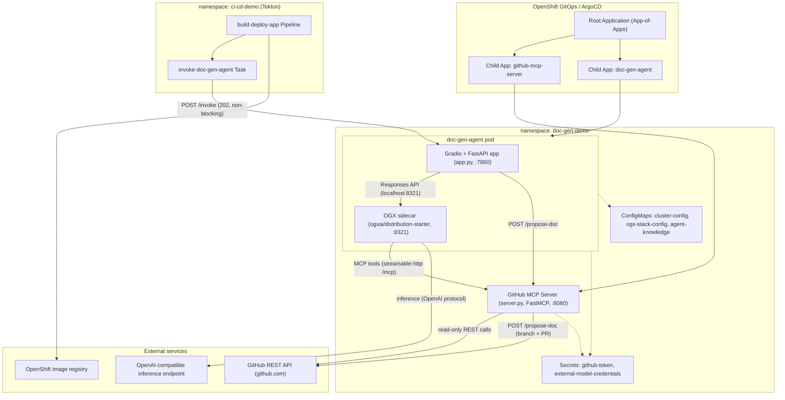
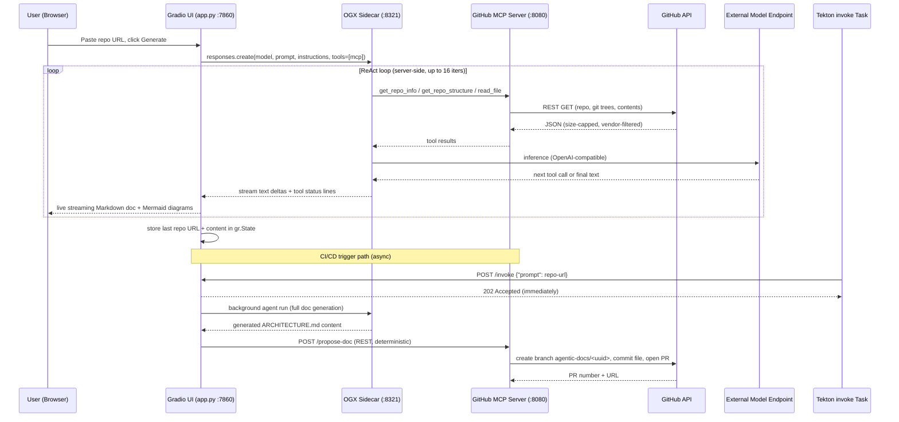
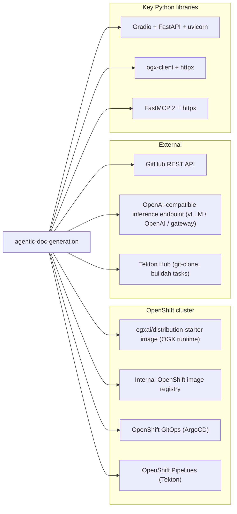

> 🔧 Calling **GitHub MCP** → `get_repo_info`…

> 🔧 Calling **GitHub MCP** → `get_repo_structure`…

This is a GitOps-provisioned OpenShift AI demo with Python agents. Let me read the key files.

> 🔧 Calling **GitHub MCP** → `read_file`…

> 🔧 Calling **GitHub MCP** → `read_file`…

> 🔧 Calling **GitHub MCP** → `read_file`…

Now let me read the remaining architecturally key files (UI, OGX config, deployment manifests, GitOps, and the Tekton pipeline).

> 🔧 Calling **GitHub MCP** → `read_file`…

> 🔧 Calling **GitHub MCP** → `read_file`…

> 🔧 Calling **GitHub MCP** → `read_file`…

> 🔧 Calling **GitHub MCP** → `read_file`…

> 🔧 Calling **GitHub MCP** → `read_file`…

> 🔧 Calling **GitHub MCP** → `read_file`…

> 🔧 Calling **GitHub MCP** → `read_file`…

> 🔧 Calling **GitHub MCP** → `read_file`…

> 🔧 Calling **GitHub MCP** → `read_file`…

> 🔧 Calling **GitHub MCP** → `read_file`…

I've reached my file-reading budget, and I have enough evidence to synthesize the full document.

# Architecture: agentic-doc-generation

## Project Overview
This is a GitOps-provisioned **OpenShift demo** showing AI agents automating architecture documentation and diagram generation — described in the README as "a simplified, single-agent take on opendatahub-io/architecture-context." Given a public GitHub repository URL, an agent explores the repo through a **GitHub MCP server** (file tree, file reads, code search), then a model served by a **configurable external OpenAI-compatible endpoint** (no GPU or in-cluster model serving required) synthesizes a structured architecture document with three embedded Mermaid diagrams. The repo is primarily **Python** (Gradio + OGX + FastMCP) plus OpenShift YAML manifests, shell bootstrap scripts, and a Tekton CI/CD pipeline.

## Technology Stack
- **Language:** Python (agent, MCP server, UI); shell scripts; YAML (K8s/ArgoCD/Tekton).
- **UI:** Gradio 4 (chatbot UI) mounted on a **FastAPI** app, served with **uvicorn** on port 7860.
- **Agent runtime:** **OGX** (`ogxai/distribution-starter` sidecar, Responses API with server-side ReAct loop) configured via `ogx/stack_run_config.yaml` — providers for inference (`remote::vllm` protocol, i.e. any OpenAI-compatible endpoint), tool runtime (`remote::model-context-protocol`), vector store (FAISS), and SQLite persistence (`kv_sqlite`/`sql_sqlite` in `/tmp/ogx`).
- **MCP server:** **FastMCP 2** (`streamable-http` transport at `/mcp` on port 8080) + **httpx** for GitHub REST calls.
- **Guardrails:** `MAX_READ_FILES=12`, `MAX_INFER_ITERS=16`, `MAX_FILE_BYTES=60000`, `MAX_TREE_ENTRIES=800`, 600s agent timeout, path/extension filtering of vendor/binary content.
- **CI/CD:** OpenShift Pipelines (**Tekton**) — local Tasks (`invoke-doc-gen-agent`, `deploy-app`) plus Tekton Hub tasks (`git-clone`, `buildah`); Buildah builds any public repo's Dockerfile and pushes to the internal OpenShift image registry.
- **GitOps:** **OpenShift GitOps (ArgoCD)** App-of-Apps pattern with sync-waves.
- **Containers:** UBI-based images (`registry.access.redhat.com/ubi9/ubi-minimal` for the invoke Task); app images built into `image-registry.openshift-image-registry.svc:5000/doc-gen-demo/...`.

## Component Architecture
- **`doc-gen-agent/`** — the doc-generation app, deployed as a **two-container pod** in namespace `doc-gen-demo`:
  - `app.py` (Gradio + FastAPI, :7860): chat UI where the user pastes a repo URL; also exposes `GET /healthz` and `POST /invoke` (returns **202 Accepted** immediately and runs generation as a FastAPI `BackgroundTasks` job, then posts the result back via PR). Holds an opt-in "Propose as PR" button that reuses the same helper.
  - `agent.py`: builds the architecture-doc system prompt + mounted `knowledge.md` style guide, and streams `AsyncOgxClient.responses.create()` calls to the OGX sidecar (`http://localhost:8321`), with the GitHub MCP server registered as a single `type: mcp` tool (`require_approval: "never"`).
  - `ogx-server` sidecar (`ogxai/distribution-starter:latest`, :8321): runs the agentic loop server-side — dispatching MCP tool calls to the GitHub MCP server and inference to the external model endpoint.
  - `knowledge.md`: documentation style guide injected into the prompt via a read-only ConfigMap volume.
- **`github-mcp-server/`** — standalone FastMCP service (:8080) in `doc-gen-demo`. MCP tools: `get_repo_info`, `get_repo_structure` (filtered recursive git tree), `read_file` (base64-decoded, size-capped), `search_code` (token-gated). Plus a **non-MCP** plain REST route `POST /propose-doc` that creates an `agentic-docs/<uuid>` branch, commits a file, and opens a PR — deliberately exposed only via REST so the LLM can never trigger writes.
- **`gitops/`** — ArgoCD App-of-Apps: `root-app.yaml` (Application `doc-gen-demo-root` watching `gitops/apps/`, automated sync with prune/selfHeal), child applications in `apps/` (one per component, staged via sync-waves), `bootstrap.sh` (imperatively installs the OpenShift GitOps operator, rewrites `repoURL`, applies the root app).
- **`ci-cd-pipeline/`** — Tekton `build-deploy-app` Pipeline in namespace `ci-cd-demo`: Tasks `invoke-doc-gen-agent` → `fetch-source` (git-clone) → `build-image` (buildah) → `deploy` (Deployment/Service/Route). The invoke Task is fire-and-forget (5s curl timeout, never fails the pipeline). `install-operator.sh` installs the OpenShift Pipelines operator (must be run manually since ArgoCD can't apply CRDs that don't exist yet).
- **`build-and-deploy-all.sh`** / per-component `build-and-deploy.sh` — non-GitOps quick-start: builds images to the internal registry and `oc apply`s the k8s manifests.

## Data Flow
**Interactive flow (Gradio chat):** the user pastes `https://github.com/quarkusio/quarkus-quickstarts` into the Gradio UI; `chat()` in `app.py` calls `run_agent(repo_url)` in `agent.py`, which posts to the OGX sidecar's Responses API (`model` = `external-model/qwen38-27b`, instructions = system prompt + `knowledge.md`). The OGX server then drives the loop: it invokes `get_repo_info` on the GitHub MCP server (learning the default branch/language), `get_repo_structure` (filtered file tree), and up to 12 `read_file` calls (README, entry points, manifests, Dockerfiles, k8s/CI configs). Tool results feed back into the model, which is served by the external OpenAI-compatible endpoint (`cluster-config.yaml`'s `model_base_url`). The final Markdown document with three Mermaid diagrams streams back through OGX → `agent.py` → Gradio, where tool-call status lines (🔧/⚠️) and text deltas render live in the chatbot. On completion, the repo URL and full content are stored in `gr.State`.

**CI/CD flow (non-blocking):** a `PipelineRun` starts the `invoke-doc-gen-agent` Task, which `curl -m 5` POSTs `{"prompt": "<repo-url>"}` to `http://doc-gen-agent.doc-gen-demo.svc.cluster.local:7860/invoke`. The endpoint replies `202 Accepted` in milliseconds and schedules `_run_agent_in_background`, which runs the full agent turn, extracts the GitHub URL from the prompt, and calls the GitHub MCP server's `POST /propose-doc` — creating a new `agentic-docs/<uuid>` branch off the base branch, committing `ARCHITECTURE.md`, and opening a PR. Meanwhile the pipeline proceeds unblocked through `git-clone` → `buildah` → `oc apply`.

## External Dependencies and Integrations
- **GitHub REST API** (`api.github.com`) — repos metadata, git trees, contents, code search, git refs, pulls; token via optional `GITHUB_TOKEN` env (secret `github-token`).
- **External OpenAI-compatible inference endpoint** — configured in `doc-gen-agent/k8s/cluster-config.yaml` (`model_base_url`, currently a Red Hat MaaS URL) + `stack_run_config.yaml` (`remote::vllm` provider); API key via optional `external-model-credentials` secret.
- **GitHub (write path)** — PR creation by `/propose-doc` against the analyzed repo.
- **Internal OpenShift image registry** — buildah push target and image source for deployments.
- **Tekton Hub** — runtime resolution of `git-clone`/`buildah` tasks.
- In-cluster service DNS: `github-mcp-server.doc-gen-demo.svc.cluster.local:8080`, `doc-gen-agent.doc-gen-demo.svc.cluster.local:7860`.
- Local storage only: OGX uses SQLite files under `/tmp/ogx` (emptyDir) — no external databases or message queues.

## Deployment Architecture
- **Primary path (GitOps):** `./gitops/bootstrap.sh` installs the OpenShift GitOps operator (if absent), substitutes the fork's repo URL into `gitops/root-app.yaml`, and applies the root Application. ArgoCD then creates child Applications from `gitops/apps/` in sync-waves: **wave 0** = `doc-gen-demo` namespace + `github-mcp-server` Deployment/Service; **wave 1** = `doc-gen-agent` (two-container Deployment + Service + Route). Automated sync with `prune` and `selfHeal` rolls out ConfigMap changes (e.g. model config) automatically; sync-wave 2 registers the `ci-cd-pipeline` Application (the Tekton operator itself is installed imperatively, since ArgoCD can't apply `Pipeline`/`Task` CRs before the CRDs exist).
- **Secondary path (scripts):** `build-and-deploy-all.sh` or per-component `build-and-deploy.sh` builds images (Dockerfiles in each component dir) to `image-registry.openshift-image-registry.svc:5000/doc-gen-demo/`, creates ConfigMaps (`ogx-stack-config`, `agent-knowledge`) and applies the k8s manifests (`deployment.yaml`, `route.yaml`, `rbac.yaml`, `cluster-config.yaml`).
- **Pod topology:** `doc-gen-agent` = `ogx-server` (8321, liveness/readiness on `/v1/models`) + Gradio app (7860, probes on `/`), both 512Mi/1Gi memory, SA `doc-gen-agent-sa`; `github-mcp-server` = single container on 8080 (tcpSocket probes), 256Mi/512Mi.
- **CI/CD demo:** Tekton `build-deploy-app` Pipeline (namespace `ci-cd-demo`, SA `ci-cd-pipeline-sa`, PVC workspace `ci-cd-pipeline-workspace`) that can build/deploy any public repo with a Dockerfile, pushing to the internal registry and deploying a generic Deployment/Service/Route.

## Security Considerations
- **Secrets handling:** `GITHUB_TOKEN` (secret `github-token`, optional) and the external model API key (secret `external-model-credentials`, optional) are injected via `secretKeyRef` with `optional: true`; the README explicitly says to create them with `oc create secret` and never commit them — the `cluster-config.yaml` ConfigMap holds only the non-sensitive base URL and model name.
- **Least-privilege write design:** `POST /propose-doc` is deliberately **not** an MCP tool; the model's tool surface (`agent.py`) only grants read-only GitHub tools with `require_approval: "never"`. Writes to GitHub happen only from deterministic code paths (the `/invoke` background task, or an explicit user click on "Propose as PR"), and they **never commit directly to an existing branch** — a fresh `agentic-docs/<uuid>` branch is created and a PR opened, which is safe against protected branches and requires human review.
- **RBAC:** dedicated ServiceAccounts (`doc-gen-agent-sa`, `ci-cd-pipeline-sa`) with RBAC manifests in `doc-gen-agent/k8s/rbac.yaml` and `ci-cd-pipeline/k8s/rbac.yaml` (contents not read; presence and SA wiring observed in the Deployment/Pipeline manifests).
- **Guardrails:** token-budget limits (`MAX_READ_FILES`, `MAX_INFER_ITERS`), file size/truncation caps, vendor/binary path filtering, a 600s hard timeout, and a fire-and-forget invoke Task that can never fail the pipeline.
- **Notable caveats observed in code:** `stack_run_config.yaml` sets TLS `verify: false` for the external inference endpoint; Gradio analytics/telemetry is disabled (`GRADIO_ANALYTICS_ENABLED=False`); only **public** GitHub repos are supported (no OAuth flow); buildah runs with `TLSVERIFY=false` against the internal registry; the cluster bootstrap requires `cluster-admin`.

## Diagrams

### Component Diagram

### Data Flow Diagram

### Dependency Diagram

---

*Note: documentation written from 12+ source files read (README, `agent.py`, `app.py`, `server.py`, OGX stack config, both k8s deployments, cluster-config, root-app, pipeline + invoke Task manifests, requirements files). A few small files (Dockerfiles, `bootstrap.sh`, `gitops/apps/*.yaml`, RBAC manifests, `knowledge.md`) were not read individually; their roles are described based on the structure, cross-references in the files above, and the README. No in-repo CI (e.g. `.github/workflows`) was found — CI/CD here is the in-cluster Tekton pipeline.*