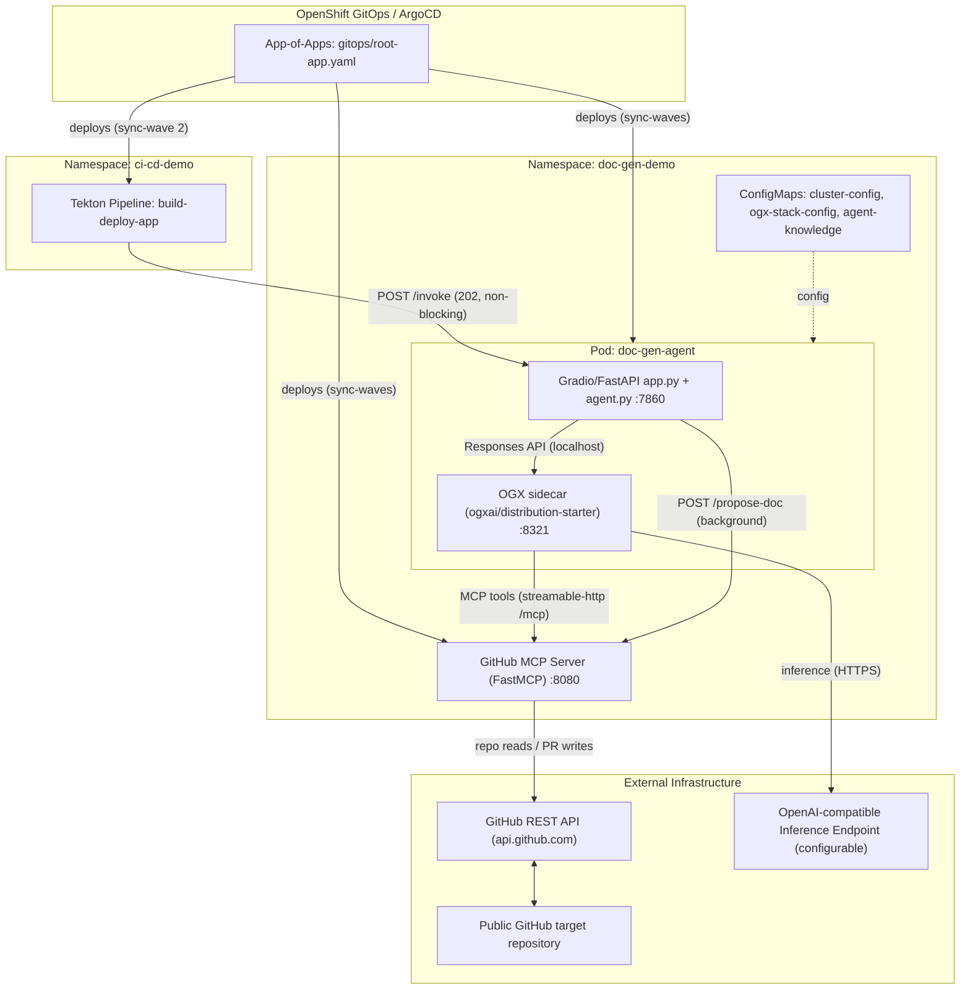
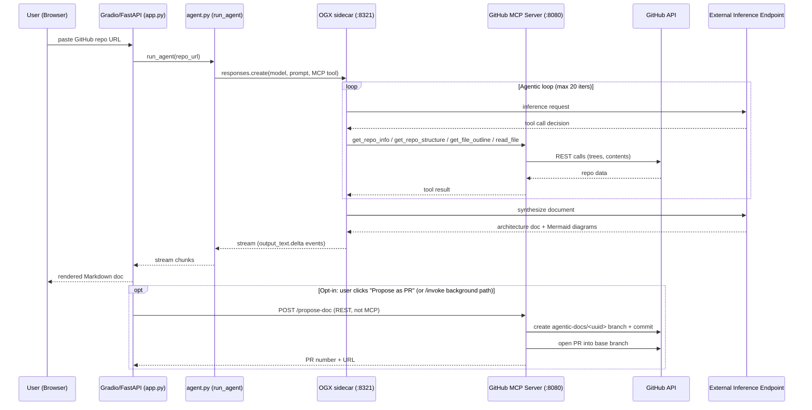
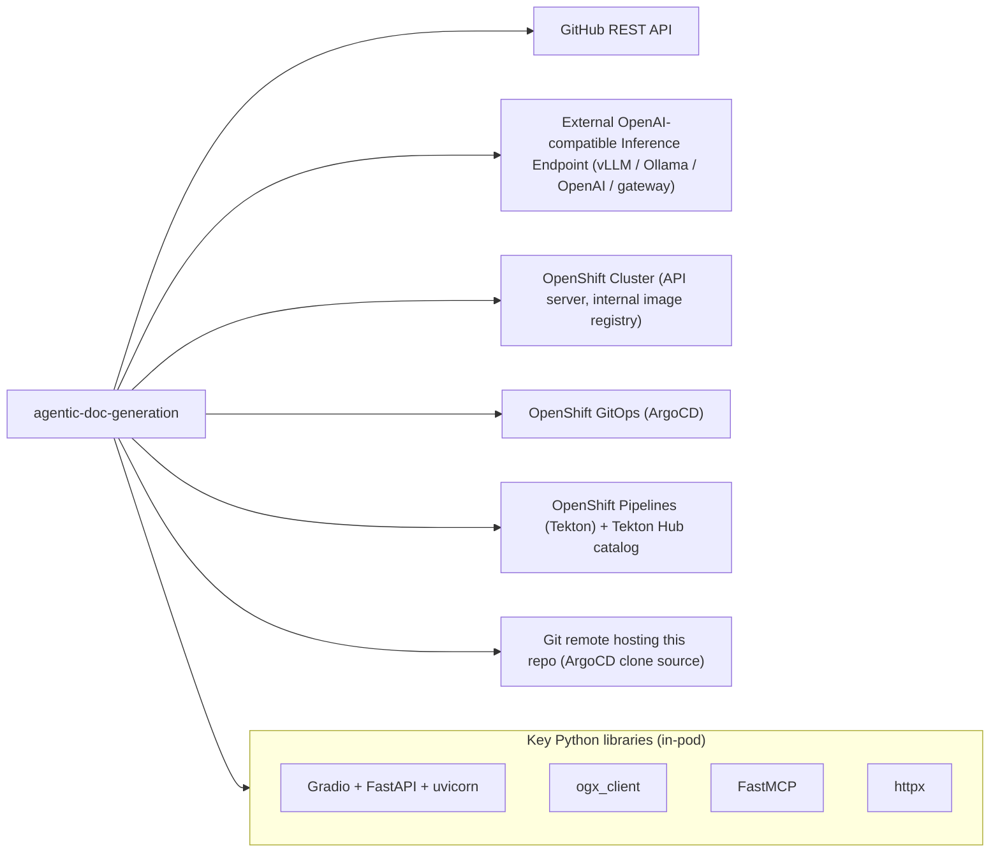

# Architecture: agentic-doc-generation

## Project Overview
A GitOps-provisioned OpenShift demo that automates architecture documentation and Mermaid diagram generation: given a GitHub repository URL, an AI agent explores the repo through a GitHub MCP server, and a model served by a configurable **external OpenAI-compatible endpoint** (no in-cluster GPU/model serving on this branch) synthesizes a structured architecture document with three embedded Mermaid diagrams. The README describes it as "a simplified, single-agent take on [opendatahub-io/architecture-context]." It is primarily Python, deployed on OpenShift via ArgoCD (App-of-Apps) and includes an OpenShift Pipelines (Tekton) demo that triggers the agent non-blockingly and proposes the result back as a PR.

## Technology Stack
- **Python 3.11** (`python:3.11-slim` base image) for both application components
- **Gradio** (chat UI, port 7860) mounted on a **FastAPI** app (serves `/`, `/healthz`, `POST /invoke`) via **uvicorn**
- **OGX** (Open Generative X) as the agent runtime — `ogxai/distribution-starter:latest` sidecar image exposing a Responses API; the agentic/ReAct loop runs server-side inside OGX, not in LangChain/LangGraph
- **FastMCP** MCP server with `streamable-http` transport at `/mcp` (port 8080)
- **httpx** for all outbound HTTP (GitHub API, OGX client)
- **OpenAI-compatible inference** via OGX `remote::vllm` provider pointed at an external endpoint (vLLM/Ollama/OpenAI/gateway — any OpenAI-compatible `/v1` URL)
- **Kubernetes/OpenShift**: Deployments, Services, Routes, ConfigMaps, optional Secrets
- **OpenShift GitOps (ArgoCD)**: App-of-Apps pattern with sync-waves
- **OpenShift Pipelines (Tekton)**: `build-deploy-app` Pipeline using hub-resolved `git-clone`/`buildah` tasks and Buildah for image builds

## Component Architecture
- **`gitops/`** — ArgoCD manifests and bootstrap. `root-app.yaml` is the App-of-Apps (`doc-gen-demo-root` in `openshift-gitops`) watching `gitops/apps/` with `prune`/`selfHeal`; child Applications per component use sync-waves (wave 0: MCP server, wave 1: agent, wave 2: CI/CD pipeline). `bootstrap.sh` imperatively installs the OpenShift GitOps operator, rewrites `repoURL`, and applies the root app.
- **`github-mcp-server/`** — Standalone FastMCP server (`server.py`, port 8080) exposing read-only repo-browsing MCP tools: `get_repo_info`, `get_repo_structure` (recursive git-tree with vendor/binary filtering, 800-entry cap), `get_file_outline` (regex-extracted imports/signatures for Python/Java/Kotlin/Go/JS/TS/YAML/Dockerfile, 4KB cap), `read_file` (60KB cap, 8KB cap for doc files), `search_code` (requires token). It also exposes a **plain REST route `POST /propose-doc`** (deliberately *not* an MCP tool) that creates an `agentic-docs/<uuid>` branch, commits the document via the Contents API, and opens a PR — never writing to an existing branch.
- **`doc-gen-agent/`** — Two-container pod in `doc-gen-demo`:
  - `doc-gen-agent` container: `app.py` builds a FastAPI app with the Gradio chat UI (user pastes a repo URL; streams agent output; opt-in "Propose as PR" button) plus REST endpoints `GET /healthz` and `POST /invoke` (returns 202 immediately; runs `_run_agent_in_background` as a starlette BackgroundTask that drains the agent and then calls `/propose-doc`).
  - `agent.py`: `run_agent()` uses `ogx_client.AsyncOgxClient` to call OGX's `responses.create()` with the architecture-doc system prompt (three-phase survey → deep-read → write workflow with `MAX_INFER_ITERS=20`, `MAX_READ_FILES=10` guardrails) and one generic `type: "mcp"` tool pointing at the MCP server with `require_approval: "never"`; streams `response.output_text.delta` events and tool-call status lines back to the UI. `extract_architecture_document()` strips UI-only artifacts for PR/commit payloads.
  - `ogx-server` sidecar (`ogxai/distribution-starter:latest`, port 8321): configured by `ogx/stack_run_config.yaml` — `remote::vllm` inference provider (base URL/API key from ConfigMap/Secret env vars), `inline::builtin` responses with SQLite persistence, `remote::model-context-protocol` tool runtime, FAISS vector store, registers the model (e.g. `external-model/qwen38-27b`) which it publishes at `/v1/models`.
  - `knowledge.md` (documentation style guide) is mounted as the `agent-knowledge` ConfigMap and appended to the system prompt; `cluster-config.yaml` ConfigMap holds `model_base_url`/`model_name`.
- **`ci-cd-pipeline/`** — Tekton `Pipeline` `build-deploy-app` in `ci-cd-demo`: `invoke-doc-gen-agent` (non-blocking POST to the agent's `/invoke`, tolerates failure) → `fetch-source` (hub `git-clone`) → `build-image` (hub `buildah`, push to internal OpenShift registry) → `deploy` (local `deploy-app` Task creating Deployment/Service/Route). RBAC for the pipeline ServiceAccount and a `pipelinerun-example.yaml` are included.
- **`build-and-deploy-all.sh`** / per-component `build-and-deploy.sh` — non-GitOps path: `oc new-app`-style build into the internal registry plus `oc apply` of the `k8s/` manifests.

## Data Flow
Interactive path: a user pastes a repo URL into the Gradio chat (port 7860). `app.py`'s `chat()` handler calls `agent.run_agent(repo_url)`, which issues `responses.create(model="external-model/<model>", instructions=<system prompt + knowledge.md>, tools=[MCP: http://github-mcp-server…:8080/mcp])` to the OGX sidecar. OGX runs the full agentic loop: the model calls `get_repo_info` → `get_repo_structure` → `get_file_outline` on 6–10 files → up to 10 `read_file` calls; each tool call goes from OGX's MCP tool runtime to the MCP server, which calls the **GitHub REST API** (`/repos/…`, `/git/trees/…`, `/contents/…`, `/search/code`). Tool results feed back to the model at the **external OpenAI-compatible inference endpoint** (`remote::vllm` provider, base URL from `cluster-config.yaml`). The final Markdown document (with Mermaid diagrams) streams back as `response.output_text.delta` events through `run_agent()` into the Gradio chatbot; `extract_architecture_document()` cleans the final text and stores it in `gr.State` for the optional "Propose as PR" button.

CI/CD path: a Tekton `PipelineRun` fires `invoke-doc-gen-agent`, which POSTs to `/invoke`; the agent responds `202 Accepted` with a `job_id` and the pipeline proceeds to git-clone/buildah/deploy immediately. The background task in `app.py` completes the full agent run server-side, extracts the document, and calls `POST /propose-doc` on the MCP server (deterministic REST, never model-mediated), which creates a new `agentic-docs/<10-hex>` branch off the base branch, commits `ARCHITECTURE.md` to it, and opens a PR into the base branch on GitHub.

## External Dependencies and Integrations
- **GitHub REST API** (`https://api.github.com`, overridable via `GITHUB_API_URL`) — repo metadata, git trees, contents, code search, refs/commits/PRs (all calls made by `github-mcp-server/server.py`)
- **External OpenAI-compatible inference endpoint** — the only model-serving dependency on this branch; configured via `cluster-config.yaml` (`model_base_url`, currently pointing at an MaaS Red Hat workshop endpoint) and `stack_run_config.yaml` (registered model). No in-cluster model serving (that design lives on the `local-model` branch with vLLM/OpenShift AI + GPU)
- **OpenShift cluster services**: internal image registry (`image-registry.openshift-image-registry.svc:5000`), ArgoCD (GitOps operator), OpenShift Pipelines/Tekton operator, `tkn` CLI for manual runs
- **Tekton Hub catalog** — `git-clone` v0.9 and `buildah` v0.4 tasks resolved at run time

## Deployment Architecture
- **GitOps (primary)**: `gitops/bootstrap.sh` installs the OpenShift GitOps operator, rewrites `repoURL` in `gitops/root-app.yaml`, applies the root Application; ArgoCD then creates child Applications from `gitops/apps/` (one per component: `github-mcp-server.yaml`, `doc-gen-agent.yaml`, `ci-cd-pipeline.yaml`) with sync-wave ordering, `CreateNamespace=true`, `prune`/`selfHeal` (ConfigMap changes roll out automatically). The `doc-gen-demo` namespace holds the MCP server and the two-container agent pod (ogx sidecar + Gradio).
- **Imperative (alternative)**: `build-and-deploy-all.sh` (or per-component `build-and-deploy.sh`) builds images into the internal OpenShift registry and applies the `k8s/` manifests; ConfigMaps `ogx-stack-config` and `agent-knowledge` are created via `oc create configmap --from-file`.
- **Container images**: `doc-gen-agent` from its own Dockerfile (python:3.11-slim, non-root UID 1001, `start.sh` health-checks the OGX sidecar via curl before serving); OGX uses the upstream `ogxai/distribution-starter:latest` image; the MCP server has its own Dockerfile/Deployment (port 8080). Probes: OGX liveness/readiness on `/v1/models:8321`, Gradio on `/:7860`; each container requests 512Mi/250m with 1Gi/1000m limits.
- **Tekton pipeline**: operator installed manually (ArgoCD can't apply Tekton CRs before CRDs exist), then `PipelineRun` builds *any* public repo's Dockerfile with Buildah and deploys a generic Deployment/Service/Route.

## Security Considerations
- **Write path is deliberately not an MCP tool**: `POST /propose-doc` is a plain REST route (comment in `server.py` explains that exposing it as a tool with `require_approval: "never"` would let the model open branches/PRs during ordinary chat). Only deterministic callers — the `/invoke` background task and an explicit user click in the UI — can trigger it.
- **PR-only writes, no direct branch commits**: the PR flow always creates a fresh `agentic-docs/<uuid>` branch off the base branch and opens a PR, so protected branches are safe; a human must review/merge.
- **Secrets handling**: `GITHUB_TOKEN` (optional; enables `search_code` and PR proposals) is injected into the MCP server as an env var; `external-model-credentials` Secret holds the inference API key and is referenced with `optional: true` (fallback to `"unused"` in `stack_run_config.yaml`). The README explicitly instructs creating the Secret via `oc create secret` — never committing it.
- **RBAC**: dedicated ServiceAccounts (`doc-gen-agent-sa` for the agent, a pipeline SA in `ci-cd-demo` with its own `rbac.yaml`); the pipeline SA's permissions scope the Tekton tasks.
- **Notable caveat**: `stack_run_config.yaml` sets `network.tls.verify: false` on the external inference provider — TLS certificate verification is disabled for the model endpoint connection. Gradio analytics/telemetry is disabled (`GRADIO_ANALYTICS_ENABLED=False`) to prevent outbound calls. The OGX sidecar authenticates to itself with a placeholder `api_key="local"` over localhost.

## Diagrams

### Component Diagram

### Data Flow Diagram

### Dependency Diagram
