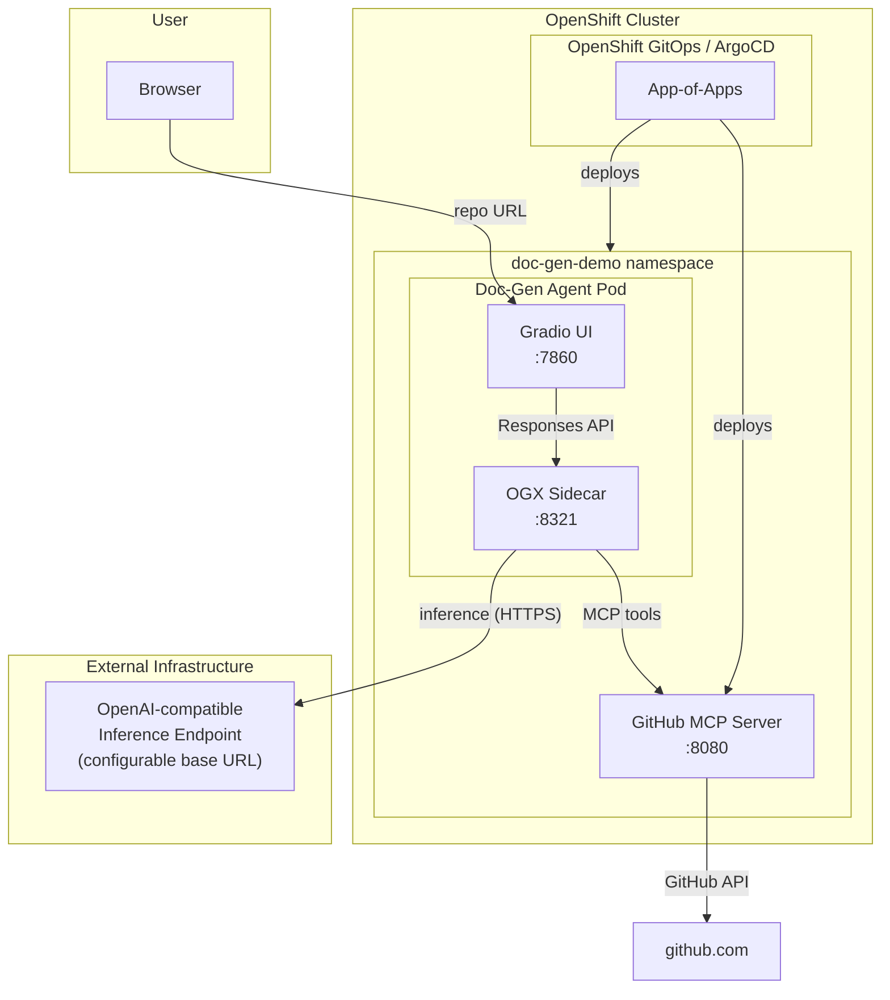
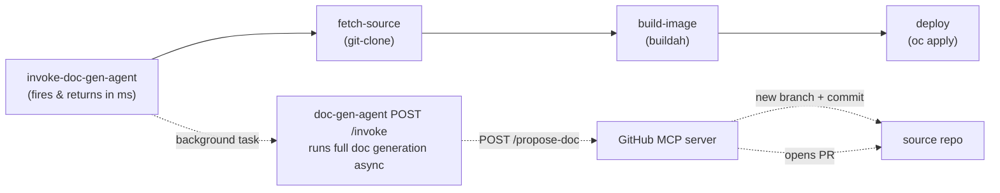

# Agentic Doc Generation — OpenShift Demo

A GitOps-provisioned demo showing an AI agent on **OpenShift** automating
architecture documentation and diagram generation — a simplified,
single-agent take on
[opendatahub-io/architecture-context](https://github.com/opendatahub-io/architecture-context).

Give the agent a GitHub repository URL. It explores the repo via a GitHub
MCP server, then a model served by **your own external, OpenAI-compatible
endpoint** (no GPU or in-cluster model serving required) synthesizes an
architecture document with embedded Mermaid diagrams.

> **Looking for the original, fully in-cluster design?** The
> [`local-model`](https://github.com/YOUR_ORG/agentic-doc-generation/tree/local-model)
> branch preserves the version where the model is served in-cluster by
> vLLM on OpenShift AI (GPU required).

## How it works



Agent workflow, simplified from architecture-context's six-phase pipeline
down to one agent turn:

1. User pastes a GitHub repo URL into the Gradio chat UI
2. Agent calls `get_repo_info` (default branch, language) then
   `get_repo_structure` (filtered file tree) on the GitHub MCP server
3. Agent reads the ~15-20 most architecturally relevant files (README,
   entry points, manifests, Dockerfiles, k8s/CI configs)
4. The configured model (served by an external OpenAI-compatible
   endpoint — your own vLLM/Ollama deployment, OpenAI, an Azure OpenAI
   gateway, etc.) synthesizes a structured architecture document:
   overview, tech stack, components, data flow, external dependencies,
   deployment, security
5. The model generates three Mermaid diagrams (component, data flow,
   dependency), embedded directly in the Markdown response
6. Everything streams back into the chat UI

## Prerequisites

- An OpenShift cluster, logged in as `cluster-admin` (`oc login`) —
  no GPU node required
- An **external OpenAI-compatible inference endpoint** reachable from the
  cluster: a base URL (e.g. `https://api.openai.com/v1`, or your own
  vLLM/Ollama/gateway deployment) and, if required, an API key
- `oc` CLI
- This repo pushed to a git remote reachable by the cluster (GitHub,
  GitLab, or an internal git server) — ArgoCD needs to clone it
- (Optional) A `GITHUB_TOKEN` with `public_repo` scope, to raise GitHub
  API rate limits and enable the `search_code` tool. Required (with its
  write access, which `public_repo` already includes) if you want the
  `/invoke` endpoint to propose the generated doc back to its source repo via PR
  — see [CI/CD pipeline demo](#cicd-pipeline-demo-openshift-pipelines)

## Quick start (GitOps)

```bash
git clone <your-fork-of-this-repo>
cd agentic-doc-generation
./gitops/bootstrap.sh
```

This single command:

1. Installs the OpenShift GitOps operator (if not already present) and
   waits for ArgoCD to come up
2. Points the root ArgoCD Application (`gitops/root-app.yaml`) at your
   repo and applies it
3. ArgoCD then reconciles everything else, in dependency order via
   sync-waves:
   - **Wave 0** — `doc-gen-demo` namespace + GitHub MCP server
   - **Wave 1** — the doc-gen agent (Gradio UI + OGX sidecar)

The script finishes by printing the ArgoCD UI route. Watch progress with:

```bash
oc get applications -n openshift-gitops -w
```

> **Note:** `bootstrap.sh` edits `gitops/apps/*.yaml` in place to
> substitute your repo's URL (ArgoCD Applications can't template this at
> apply-time). Commit and push that change so ArgoCD's view of the repo
> matches what you applied:
> ```bash
> git add gitops/apps && git commit -m "gitops: point apps at repo" && git push
> ```

Before (or right after) the doc-gen agent comes up, point it at your
external model endpoint — see [Model configuration](#model-configuration)
below.

Once `doc-gen-agent` is `Synced`/`Healthy`, get the UI route:

```bash
oc get route doc-gen-agent -n doc-gen-demo -o jsonpath='https://{.spec.host}{"\n"}'
```

## Quick start (without GitOps)

For local iteration on the application components only:

```bash
export GITHUB_TOKEN=ghp_xxx                 # optional, raises rate limits + enables search_code + propose-doc
export EXTERNAL_MODEL_API_KEY=sk-xxx        # optional, depends on your endpoint
./build-and-deploy-all.sh
```

Or deploy a single component:

```bash
./build-and-deploy-all.sh github-mcp-server
./build-and-deploy-all.sh doc-gen-agent
```

## Demo walkthrough

1. Open the doc-gen agent route in a browser
2. Paste a repo URL, e.g. `https://github.com/quarkusio/quarkus-quickstarts`
   (or use one of the example buttons in the UI)
3. Watch the agent:
   - Call `get_repo_info` → learns the default branch and primary language
   - Call `get_repo_structure` → sees the filtered file tree
   - Call `read_file` repeatedly → reads the README, main source files,
     build manifests, Dockerfiles, k8s manifests
   - Stream back a full architecture document with three embedded Mermaid
     diagrams (component, data flow, dependency)
4. Try a few different repos to see how the output adapts — a small CLI
   tool produces a much shorter document than a multi-service platform

## Model configuration

The agent calls whatever OpenAI-compatible endpoint you point it at —
your own vLLM/Ollama deployment, a hosted provider like OpenAI, or an
internal gateway. Configure it in two places:

| File | What to set |
|---|---|
| [`doc-gen-agent/k8s/cluster-config.yaml`](doc-gen-agent/k8s/cluster-config.yaml) | `data.model_base_url` (the endpoint's OpenAI-compatible `/v1` base URL) and `data.model_name` |
| [`doc-gen-agent/ogx/stack_run_config.yaml`](doc-gen-agent/ogx/stack_run_config.yaml) | `registered_resources.models[0].model_id` / `provider_model_id` (must match `model_name` above and the identifier your endpoint expects) |

If the endpoint requires an API key, create a Secret (not committed to
git):

```bash
oc create secret generic external-model-credentials \
  --from-literal=api_key=<your-api-key> -n doc-gen-demo
```

`doc-gen-agent/k8s/deployment.yaml` reads this Secret optionally — leave
it unset for endpoints that don't require auth.

If using GitOps, commit and push the `cluster-config.yaml` /
`stack_run_config.yaml` changes — ArgoCD's `selfHeal` will roll them out
automatically. The Secret itself should never be committed; create it
directly with `oc` as shown above.

## Project structure

```
agentic-doc-generation/
├── gitops/
│   ├── bootstrap.sh                     # Install GitOps operator, apply root app
│   ├── root-app.yaml                    # ArgoCD App-of-Apps
│   ├── openshift-gitops-subscription.yaml
│   └── apps/                            # Child ArgoCD Applications (one per component)
├── github-mcp-server/                   # FastMCP server: get_repo_info, get_repo_structure, read_file, search_code, POST /propose-doc
│   ├── server.py
│   ├── Dockerfile
│   ├── build-and-deploy.sh
│   └── k8s/
├── doc-gen-agent/                       # OGX sidecar + Gradio UI
│   ├── agent.py                         # OGX Responses API agent, architecture-focused system prompt
│   ├── app.py                           # Gradio chat UI
│   ├── knowledge.md                     # Documentation style guide injected into the agent prompt
│   ├── ogx/stack_run_config.yaml        # OGX + external model config
│   ├── build-and-deploy.sh
│   └── k8s/
├── ci-cd-pipeline/                      # OpenShift Pipelines (Tekton) build/deploy demo
│   ├── install-operator.sh              # One-time: installs the OpenShift Pipelines operator
│   ├── build-and-deploy.sh
│   ├── pipelinerun-example.yaml
│   └── k8s/
├── build-and-deploy-all.sh              # Quick-start (non-GitOps) for app components
└── README.md
```

## CI/CD pipeline demo (OpenShift Pipelines)

[`ci-cd-pipeline/`](ci-cd-pipeline/) adds a self-contained Tekton
`build-deploy-app` Pipeline that demonstrates how an external CI/CD run
can **trigger the doc-gen agent without blocking** on it: before building
or deploying anything, the pipeline POSTs to the agent's `/invoke`
endpoint, which accepts the request (`202 Accepted`) and runs the actual
documentation generation in the background — so the pipeline's
build/deploy steps proceed immediately rather than waiting minutes for a
full agent turn. Once that background run finishes, the agent proposes
the generated document (`ARCHITECTURE.md` by default) back to the repo it
analyzed as a **pull request**: it creates a new branch, commits the doc
there, and opens a PR against the base branch via the GitHub MCP server's
`POST /propose-doc` route — it never writes directly to an existing
branch, so this is safe even against a protected `main`.



The pipeline builds the target repo's `Dockerfile` with Buildah, pushes
to the internal OpenShift registry, and deploys a generic
Deployment/Service/Route for it — so it works with **any public repo
that has a Dockerfile**, not just this one.

Prerequisites: the Red Hat **OpenShift Pipelines** operator (Tekton), and
a `GITHUB_TOKEN` (`public_repo` scope is sufficient — it includes write
access) configured on the GitHub MCP server, so it can open a PR against
the repo you point the pipeline at. Without a token, doc generation still
runs; the PR step just logs a warning and is skipped.

```bash
./ci-cd-pipeline/install-operator.sh    # one-time: installs the operator, waits for its CRDs
./ci-cd-pipeline/build-and-deploy.sh    # applies the Namespace/RBAC/Tasks/Pipeline
oc create -f ci-cd-pipeline/pipelinerun-example.yaml -n ci-cd-demo
tkn pipelinerun logs -f -n ci-cd-demo
```

Or substitute any public repo/app name directly with the `tkn` CLI:

```bash
tkn pipeline start build-deploy-app -n ci-cd-demo \
  -p repo-url=https://github.com/<org>/<repo> \
  -p app-name=<name> \
  -w name=shared-workspace,claimName=ci-cd-pipeline-workspace \
  --serviceaccount=ci-cd-pipeline-sa
```

If using GitOps, `gitops/apps/ci-cd-pipeline.yaml` registers this
component as an ArgoCD-managed child Application (sync-wave 2) — but the
operator install step above must still be run manually first, since
ArgoCD can't apply `Pipeline`/`Task` resources before their CRDs exist
(the same reason `gitops/bootstrap.sh` installs the OpenShift GitOps
operator itself imperatively).

## Known limitations

- This demo analyzes **public** GitHub repos only (the GitHub MCP server
  uses unauthenticated or token-based REST calls, no OAuth flow).
- `search_code` requires a `GITHUB_TOKEN` (GitHub's code search API does
  not support unauthenticated requests).
- Proposing the generated doc back to its source repo (via `/invoke` →
  `POST /propose-doc`) requires a `GITHUB_TOKEN` with write access. It
  always creates a fresh `agentic-docs/<random>` branch off the base
  branch (the repo's default branch, or `ARCHITECTURE_DOC_BASE_BRANCH` if
  set) and opens a PR into it — it never pushes directly to an existing
  branch, so it's safe against protected branches, but someone still has
  to review and merge the PR. This only happens for `/invoke` (the CI/CD
  trigger path); the interactive Gradio chat UI never writes to GitHub.
- The agent reads file contents one at a time; very large monorepos will
  hit the `MAX_INFER_ITERS` / token-budget guardrails in
  [`doc-gen-agent/agent.py`](doc-gen-agent/agent.py) and produce a
  partial-but-useful document rather than exhaustive coverage — this
  mirrors the token-budget tuning notes in the reference
  ocp-troubleshooter-demo.
- Inference quality and latency depend entirely on the external endpoint
  you configure — this repo does not provision or manage that endpoint.
