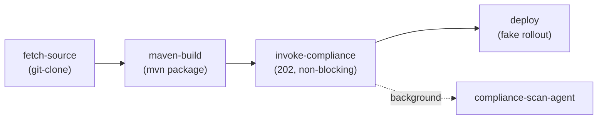

# Agentic Doc Generation — OpenShift Demo

A GitOps-provisioned demo showing four independent AI agents on
**OpenShift** generating repository documentation and catalog metadata,
and checking architectural compliance — a simplified take on
[opendatahub-io/architecture-context](https://github.com/opendatahub-io/architecture-context).

The demo targets **Java application repositories**. For OpenAPI generation,
use Java HTTP services with Spring MVC/Spring Boot or JAX-RS-style
controllers/resources and DTOs. Java-only describes the supported demo
scope; the application does not currently enforce a repository-language gate.

Give any agent a GitHub repository URL. Each explores the repo via a
shared GitHub MCP server and synthesizes its output through its OGX
sidecar and the in-cluster OpenShift AI AI Gateway / Models-as-a-Service.
The gateway fronts **your own external, OpenAI-compatible endpoint**
(no GPU or in-cluster model serving required):

- **doc-gen-agent** — an architecture document with embedded Mermaid (C4)
  diagrams, with an opt-in "Propose as PR" button
- **openapi-gen-agent** — an OpenAPI 3.0.x specification (YAML), for Java repos
  that look like HTTP API services and don't already ship one, with its
  own opt-in "Propose as PR" button
- **compliance-scan-agent** — a Markdown report checking Kubernetes/OpenShift
  manifests, project structure, and Maven `pom.xml` against separate
  guideline files; never opens a PR
- **catalog-gen-agent** — generates or augments Backstage `catalog-info.yaml`
  with a Component and applicable API entities, with its own opt-in
  "Propose as PR" button

The four agents are fully independent components: separate pods,
UIs/routes, and run budgets. No agent triggers another. The three
PR-capable agents create separate proposals; compliance scanning only
reports findings. All four expose their own `POST /invoke` endpoint.

Two supporting services provide governance: **Governance Hub** is an
independent dashboard and REST API with persistent run history, checks,
and explicit remediation triggers for all four agents;
**Compliance MCP Server** exposes that state as read-only tools.
The optional Developer Hub plugin embeds the Hub dashboard.

> **Looking for the original, fully in-cluster design?** The
> [`local-model`](https://github.com/YOUR_ORG/agentic-doc-generation/tree/local-model)
> branch preserves the version where the model is served in-cluster by
> vLLM on OpenShift AI (GPU required).

## How it works

```mermaid
flowchart TB
    subgraph user [User / operator workstation]
        Browser
        PortalDeploy["Imperative portal deploy scripts"]
        AIInstall["install-openshift-ai.sh"]
    end

    subgraph ocp [OpenShift Cluster]
        subgraph gitops [OpenShift GitOps / ArgoCD]
            AppOfApps["App-of-Apps"]
        end

        subgraph demo_ns [doc-gen-demo namespace]
            subgraph doc_pod [Doc-Gen Agent Pod]
                DocGradio["Gradio UI\n:7860"]
                DocOGX["OGX Sidecar\n:8321"]
            end
            subgraph api_pod [OpenAPI-Gen Agent Pod]
                ApiGradio["Gradio UI\n:7860"]
                ApiOGX["OGX Sidecar\n:8321"]
            end
            subgraph scan_pod [Compliance-Scan Agent Pod]
                ScanGradio["Gradio UI\n:7860"]
                ScanOGX["OGX Sidecar\n:8321"]
            end
            subgraph catalog_pod [Catalog-Gen Agent Pod]
                CatalogGradio["Gradio UI\n:7860"]
                CatalogOGX["OGX Sidecar\n:8321"]
            end
            GitHubMCP["GitHub MCP Server\n:8080"]
            ComplianceMCP["Compliance MCP Server\n:8080"]
            GovHub["Governance Hub\nFastAPI dashboard + REST :7860"]
            GovDB[("SQLite on governance-hub-data PVC")]
        end

        subgraph mcp_gw_ns [mcp-gateway namespace]
            MCPGateway["MCP Gateway\nTokenReview + virtual servers"]
        end

        subgraph keycloak_ns [rhdh-keycloak namespace]
            RHBK["Red Hat Build of Keycloak\nplatform realm\n(isolated from cluster OAuth)"]
        end

        subgraph rhdh_ns [rhdh namespace]
            RHDH["Red Hat Developer Hub\nBackstage + plugins"]
        end

        subgraph model_gw_ns [openshift-ingress namespace]
            AIGateway["OpenShift AI AI Gateway / MaaS\nmaas-default-gateway"]
        end
    end

    subgraph external [External Infrastructure]
        InferenceEndpoint["Upstream OpenAI-compatible\nendpoint"]
        GitHub["github.com"]
    end

    Browser -->|"repo URL"| DocGradio
    Browser -->|"repo URL"| ApiGradio
    Browser -->|"repo URL"| ScanGradio
    Browser -->|"repo URL"| CatalogGradio
    Browser -->|"dashboard"| GovHub
    Browser -->|"OIDC login"| RHDH
    DocGradio -->|"Responses API"| DocOGX
    ApiGradio -->|"Responses API"| ApiOGX
    ScanGradio -->|"Responses API"| ScanOGX
    CatalogGradio -->|"Responses API"| CatalogOGX
    DocOGX -->|"MCP tools via gateway"| MCPGateway
    ApiOGX -->|"MCP tools via gateway"| MCPGateway
    ScanOGX -->|"MCP tools via gateway"| MCPGateway
    CatalogOGX -->|"MCP tools via gateway"| MCPGateway
    DocOGX -->|"inference (MaaS key)"| AIGateway
    ApiOGX -->|"inference (MaaS key)"| AIGateway
    ScanOGX -->|"inference (MaaS key)"| AIGateway
    CatalogOGX -->|"inference (MaaS key)"| AIGateway
    AIGateway -->|"upstream key"| InferenceEndpoint
    MCPGateway --> GitHubMCP
    MCPGateway -->|"compliance-tools"| ComplianceMCP
    ComplianceMCP -->|"read-only REST"| GovHub
    GovHub --> GovDB
    GovHub -->|"file-tree REST checks"| GitHubMCP
    GovHub -->|"explicit POST /invoke"| DocGradio
    GovHub -->|"explicit POST /invoke"| ApiGradio
    GovHub -->|"explicit POST /invoke"| ScanGradio
    GovHub -->|"explicit POST /invoke"| CatalogGradio
    DocGradio -.->|"optional chat / invoke callbacks"| GovHub
    ApiGradio -.->|"optional chat / invoke callbacks"| GovHub
    ScanGradio -.->|"optional chat / invoke callbacks"| GovHub
    CatalogGradio -.->|"optional chat / invoke callbacks"| GovHub
    GitHubMCP -->|"GitHub API"| GitHub
    RHDH -->|"OIDC"| RHBK
    RHDH -->|"Governance Hub plugin iframe"| GovHub
    AppOfApps -->|deploys| GitHubMCP
    AppOfApps -->|deploys| MCPGateway
    AppOfApps -->|deploys| doc_pod
    AppOfApps -->|deploys| api_pod
    AppOfApps -->|deploys| scan_pod
    AppOfApps -->|deploys| catalog_pod
    AppOfApps -->|deploys| GovHub
    AppOfApps -->|deploys| GovDB
    AppOfApps -->|deploys| ComplianceMCP
    PortalDeploy -->|"keycloak/build-and-deploy.sh"| RHBK
    PortalDeploy -->|"developer-hub/build-and-deploy.sh"| RHDH
    AIInstall -->|"platform prerequisites + model wiring"| AIGateway
```



App-of-Apps owns the application manifests, including the two `MCPServer`
CRs whose Deployments and Services are reconciled by the lifecycle
operator. Keycloak and RHDH are deployed by their imperative scripts;
there are no child Applications for them. The OpenShift AI installer
enables the model gateway and applies its platform wiring, including
`ExternalProvider` / `ExternalModel` resources in `llm`. Only the upstream
inference endpoint and GitHub are external to OpenShift.

Agent workflow, simplified from architecture-context's six-phase pipeline
down to one agent turn each — run independently by whichever agent the
user invokes:

**doc-gen-agent:**
1. User pastes a GitHub repo URL into the Gradio chat UI
2. Agent calls `get_repo_info` (default branch, language) then
   `get_repo_structure` (filtered file tree) on the GitHub MCP server
3. Agent surveys 6–10 relevant files with `get_file_outline`, then reads
   selected implementations/configuration in full. The prompt budgets at
   most eight `read_file` calls (`MAX_READ_FILES=8` in the Deployment),
   including at most one README-style document. It avoids rereading the
   same path and reserves inference iterations for synthesis.
4. The configured model (reached through the in-cluster OpenShift AI
   AI Gateway / Models-as-a-Service, which fronts an upstream
   OpenAI-compatible endpoint) synthesizes a structured architecture
   document: overview, tech stack, components, data flow, external
   dependencies, deployment, security
5. The model generates three Mermaid C4 diagrams (context, container,
   component), embedded directly in the Markdown response
6. Everything streams back into the chat UI

**openapi-gen-agent:**

1. User pastes a Java HTTP service's GitHub repo URL into its own Gradio chat UI
2. Agent fetches the repo's file tree (zero model budget) and checks
   whether it already ships an OpenAPI/Swagger spec, or looks like an
   HTTP API service without one
3. The application classifies `.java` files by controller/resource and
   DTO/model naming conventions, handing the model at most four controller
   files and three model files. The model uses `get_file_outline` for
   signatures and annotations, and `read_file` only for model/DTO details
   missing from outlines. Its system prompt prohibits further repository
   discovery and full controller reads.
4. The configured model is instructed to derive an OpenAPI 3.0.x
   specification from the observed Java annotations and model signatures.
5. Output streams to chat. YAML and OpenAPI 3.0 schema validation gate
   the PR-ready result and both proposal paths. Generated specifications
   must be self-contained, using local JSON-pointer `$ref` references;
   YAML aliases and external references are rejected. Schema validation
   does not prove that endpoints or schemas match the source: review the
   output before proposing or merging it.

Coverage is bounded by those candidates and the inference budget. Java
services with unconventional filenames, programmatic route registration,
or details absent from outlines may be missed or incompletely described.
The fallback message requesting broader discovery conflicts with the
system prompt; it is not a supported discovery path. Non-Java discovery
is outside the demo scope.

**compliance-scan-agent:**

1. Its UI or `/invoke` receives a GitHub repository URL independently of
   the other agents.
2. The application prefetches the file tree and classifies relevant
   manifests, build files, and project-structure signals.
3. The agent reads selected evidence and checks it against
   [`k8s-manifests.md`](compliance-scan-agent/guidelines/k8s-manifests.md),
   [`project-structure.md`](compliance-scan-agent/guidelines/project-structure.md),
   and [`pom-xml.md`](compliance-scan-agent/guidelines/pom-xml.md).
   These separate files are loaded into the system prompt at runtime.
4. It produces a Markdown report with PASS/FAIL/SKIP findings, evidence,
   severity, and suggested remediation. Chat streams the report; `/invoke`
   runs in the background and sends it to Governance Hub when configured.
5. The report is the deliverable: this agent never opens a PR or changes
   the analyzed repository. Chat outcomes also use the optional Hub callback.

**catalog-gen-agent:**

1. Its own UI or `/invoke` receives a GitHub repository URL.
2. The application prefetches the file tree, identifying an existing
   catalog file, build/deployment metadata, and API signals.
3. The agent reads selected files using guidance from
   [`catalog-component.md`](catalog-gen-agent/guidelines/catalog-component.md)
   and [`api-detection.md`](catalog-gen-agent/guidelines/api-detection.md),
   loaded separately into its system prompt.
4. It generates or augments `catalog-info.yaml` with a Backstage Component
   and applicable API entities for evidenced REST/OpenAPI, gRPC, GraphQL,
   or AsyncAPI surfaces. API definitions may reference existing specs;
   incomplete definitions require review.
5. Chat streams YAML for review; an explicit **"Propose as PR"** click
   proposes it on an `agentic-catalog/*` branch. `/invoke` generates and
   attempts the proposal in the background, independently of other agents.

## Governance services

### Governance Hub (`governance-hub/`)

The Hub is an independent FastAPI service with an HTML dashboard at `/`,
per-repository pages, and a REST API. It records tracked repositories,
agent runs, outcomes, PR links, and compliance-scan reports. Repositories
are discovered through run callbacks or explicit remediation requests;
there is no automatic organization-wide scan.

Its SQLite database is stored at `DATABASE_PATH` (default
`/data/governance.db`) on the `governance-hub-data` PVC mounted at `/data`.
The [models](governance-hub/models.py) and
[compliance checker](governance-hub/compliance.py) belong to this backend,
separately from the Developer Hub plugin that embeds its dashboard.

| Interface | Purpose |
|---|---|
| `GET /api/repos` | List tracked repositories and their current status |
| `GET /api/repos/{owner}/{repo}/status` | Read status and recorded run history |
| `POST /api/runs` | Receive optional agent outcome callbacks |
| `POST /api/repos/{owner}/{repo}/check` | Refresh artifact checks through the GitHub MCP server's file-tree REST API; no model call |
| `POST /api/repos/{owner}/{repo}/remediate` | Explicitly trigger any of the four agents via its `/invoke`; body selects `doc-gen`, `openapi-gen`, `catalog-gen`, or `compliance-scan` |

Artifact checks look for architecture documentation and OpenAPI files on
the default branch; they check presence, not content quality. Opening a
PR does not establish that its output has been merged. The `compliant`
flag reflects architecture-document presence; the separate violations
list can also include missing OpenAPI or compliance-scan findings.

These signals are independent: a repository can be `compliant: true`
while still listing OpenAPI or scan violations. `null` artifact fields
mean not checked; a successful tree check sets OpenAPI presence even if
no OpenAPI generation has run. Catalog runs and PR links appear in history
but do not change the compliance flag or add a catalog requirement.

Checks run after callbacks or an explicit **Refresh compliance check** /
`POST .../check`; there is no scheduled refresh. A failed refresh retains
previous artifact values, while `last_compliance_check` records the attempted
check. The filtered, bounded tree can miss files. PR links/statuses record
the latest reported proposal; refresh does not query GitHub for PR merge
status. Merge into the default branch and refresh to update artifact badges.

Agent reporting is optional through `GOVERNANCE_HUB_URL`; an empty value
disables callbacks, and a Hub outage does not block generation. All four
agents report chat and `/invoke` outcomes; the three PR-capable agents also
report explicit UI proposal outcomes with PR links or errors. History
distinguishes `ui`, `ui-pr`, `invoke`, and Hub-triggered runs. Callback
failures are logged, without retry or durable delivery. The agents remain independent, and the Hub
uses their public HTTP interfaces rather than their internals.

### Compliance MCP Server (`compliance-mcp-server/`)

This standalone FastMCP service exposes **streamable HTTP at `/mcp`** on
port 8080. Each tool is a read-only proxy to the Hub's existing REST API:

| Tool | Result |
|---|---|
| `get_compliance_status(repo_url)` | A tracked repository's current status, without run history; `tracked: false` if unknown |
| `list_violations()` | Tracked repositories with a non-empty violations list |
| `list_tracked_repos()` | All repositories known to the Hub and their status |
| `get_repo_history(repo_url)` | Recorded runs and PR links for one repository |

`GOVERNANCE_HUB_URL` selects the backend. The server has no database,
state, or shared PVC: it calls `GET /api/repos` and
`GET /api/repos/{owner}/{repo}/status`, returning an error when the Hub
cannot be reached. Clients can use the gateway's `compliance-tools`
virtual server with appropriate gateway authentication. Catalog and
Playground entries retain the direct Service `/mcp` URL.

## Prerequisites

- An OpenShift cluster, logged in as `cluster-admin` (`oc login`) —
  no GPU node required
- **Red Hat OpenShift AI, installed with `mcplifecycleoperator` + MCP Gateway operators** and
  AI Gateway / Models-as-a-Service enabled** (see
  [`install-openshift-ai.sh`](install-openshift-ai.sh)) — run this
  imperatively *before* `gitops/bootstrap.sh` /
  `build-and-deploy-all.sh`. Pass `UPSTREAM_MODEL_API_KEY` so the script
  can register the workshop `ExternalProvider` and mint a MaaS API key
  into `external-model-credentials`. `github-mcp-server` and
  `compliance-mcp-server` are deployed as `MCPServer` custom resources
  (`k8s/mcpserver.yaml`, reconciled by this operator), and then calls
  [`install-mcp-gateway.sh`](install-mcp-gateway.sh) for Connectivity
  Link + the MCP Gateway Operator (Technology Preview;
  `MCPGatewayExtension` / `AuthPolicy` / virtual servers). Distinct from
  DataScienceCluster `aigateway`, which is the model gateway: installer
  step 6 sets both `aigateway.managementState` and its nested
  `modelsAsAService.managementState` to `Managed` after platform
  prerequisites are ready. This enables routing and governance for the
  external model; it does not deploy local model weights or GPU serving.
  After GitOps syncs Gateway `mcp-gateway`, re-run
  `./install-mcp-gateway.sh` alone if `cluster-config` `mcp_gateway_url`
  is still empty. The four agents send MCP tools through the gateway
  (projected SA token, audience `mcp-gateway`,
  `X-Mcp-Virtualserver: mcp-gateway/github-tools`); REST
  (`/propose-doc`, `/repo-structure`) stays on the GitHub MCP Service.
  Gen AI Playground catalog entries keep the direct Service `/mcp` URLs
  (that ConfigMap cannot present a rotating SA token). The same
  imperative-prerequisite pattern as the CI/CD pipeline's Tekton CRDs —
  ArgoCD/`oc apply` can't create a custom resource before its CRD
  exists. This also makes both servers visible under OpenShift AI's
  AI Hub "Deployed MCP Servers" tab.
- An **upstream OpenAI-compatible inference endpoint** reachable from the
  cluster (registered as an `ExternalProvider` behind the AI Gateway) and
  its API key (`UPSTREAM_MODEL_API_KEY`). Agents never call this URL
  directly — they call the in-cluster gateway with a MaaS `sk-oai-` key.
- `oc` CLI
- Python 3 for configuration merging (and PyYAML for the optional
  configuration-reading helpers and offline deployment tests)
- This repo pushed to a git remote reachable by the cluster (GitHub,
  GitLab, or an internal git server) — ArgoCD needs to clone it
- (Optional) A `GITHUB_TOKEN` to raise GitHub API rate limits and enable
  the `search_code` tool. Proposing output as a PR requires the token to
  have write access to the target repository — see
  [CI/CD pipeline demo](#cicd-pipeline-demo-openshift-pipelines)

## Quick start (GitOps)

```bash
git clone <your-fork-of-this-repo>
cd agentic-doc-generation
UPSTREAM_MODEL_API_KEY=sk-... ./install-openshift-ai.sh   # RHOAI + AI Gateway / MaaS
./ci-cd-pipeline/install-operator.sh                    # required Tekton CRDs
bash gitops/prepare.sh                                 # images + generated ConfigMaps
./gitops/bootstrap.sh
# Complete gateway configuration after Argo CD creates wave 0:
oc wait --for=create gateway/mcp-gateway -n mcp-gateway --timeout=300s
./install-mcp-gateway.sh
```

`install-openshift-ai.sh` installs OpenShift AI (including AI Gateway /
Models-as-a-Service), registers the upstream model, and mints a MaaS key
into `external-model-credentials`. OpenShift Pipelines must also be
installed before bootstrap because the App-of-Apps includes Tekton resources.

`gitops/prepare.sh` runs the seven application component build scripts with
`PREPARE_ONLY=true`: it creates/labels `doc-gen-demo`, builds their internal
`:latest` images, applies prerequisite RBAC and the Hub PVC, and generates
the OGX/knowledge ConfigMaps and configured agent credentials. It does not
apply application Deployments, Services, Routes, or `MCPServer` CRs, or
deploy the portal/pipeline. It reuses the same binary-build helper as normal
component builds. Quay remains the default sidecar source; a private image
needs suitable pull credentials. For GitOps, commit any sidecar image
override in the four Deployments and `cluster-config` before bootstrap;
setting a shell-only image override during preparation does not update GitOps.

Preparation builds from the local checkout, while Argo CD reads your remote.
Push manifest changes before bootstrap. Preparation on an existing cluster
updates mutable image tags/configuration; it is not a read-only audit or a
workload restart command. For an existing deployment, follow the explicit
[configuration and rollout instructions](#configuration-updates-and-restarts).

Then `gitops/bootstrap.sh`:

1. Installs the OpenShift GitOps operator (if not already present) and
   waits for ArgoCD to come up
2. Runs **`gitops/preflight.sh`** (checks MCPServer, AuthPolicy,
   MCPGatewayExtension, and Tekton CRDs plus all seven application image
   tags and all shared/knowledge ConfigMaps; warns on missing AI Gateway
   or model Secrets). Missing required preparation stops bootstrap;
   `GITOPS_PREFLIGHT_WARN_ONLY=1` is an explicit diagnostic bypass.
3. Applies **`gitops/argocd-namespace-rolebindings.yaml`** so the Argo CD
   application-controller can reconcile **`doc-gen-demo`**,
   **`ci-cd-demo`**, and **`mcp-gateway`** (required on OpenShift GitOps
   1.22+ — see [GitOps RBAC](#gitops-rbac) below)
4. Optionally creates **`external-model-credentials`** /
   **`github-token`** when **`EXTERNAL_MODEL_API_KEY`** / **`GITHUB_TOKEN`**
   are set in the shell
5. Points the root ArgoCD Application (`gitops/root-app.yaml`) at your
   repo and applies it
6. ArgoCD then reconciles every child Application under `gitops/apps/`,
   in dependency order via sync-waves:
   - **Wave 0** — `doc-gen-demo` namespace + GitHub MCP server + MCP
     Gateway (`mcp-gateway` Application: Gateway, extension, AuthPolicy,
     registrations, virtual servers, HTTPRoutes)
   - **Wave 1** — doc-gen-agent, openapi-gen-agent, catalog-gen-agent,
     compliance-scan-agent, governance-hub, and compliance-mcp-server,
     applied concurrently — MCP tools go through the gateway; REST and
     governance still use wave 0 / peer Service DNS (compliance-mcp
     tolerates governance-hub briefly unavailable — see
     `.cursor/rules/gitops-conventions.mdc`). After the Gateway is
     created, finish the quick-start URL step above: `install-mcp-gateway.sh`
     waits for Programmed, sets `mcp_gateway_url`, and restarts existing
     agents so their environment picks it up. Do this before expecting
     successful agent runs, even if their UIs are already Healthy.
   - **Wave 2** — CI/CD pipeline (Tekton resources)

   **Keycloak and Red Hat Developer Hub are *not* part of this
   App-of-Apps tree** — there is no `gitops/apps/keycloak.yaml` or
   `gitops/apps/developer-hub.yaml`. Both are **imperative-only**: deploy
   them yourself with `keycloak/build-and-deploy.sh` and
   `developer-hub/build-and-deploy.sh` (see
   [Developer portal (RHDH + Keycloak)](#developer-portal-rhdh--keycloak)
   below) *after* `gitops/bootstrap.sh` has finished. The
   `argocd.argoproj.io/sync-wave`/Sync-hook annotations already present
   in their manifests only take effect if you add the corresponding
   `gitops/apps/*.yaml` child Applications yourself — this repo doesn't
   ship them.

The script finishes by printing the ArgoCD UI route. Watch progress with:

```bash
oc get applications -n openshift-gitops -w
```

> **Note:** `bootstrap.sh` edits `gitops/apps/*.yaml` in place to
> substitute your repo's URL (ArgoCD Applications can't template this at
> apply-time). Commit and push that change so ArgoCD's view of the repo
> matches what you applied:
> ```bash
> git add gitops/apps && git commit -m "gitops: point apps at repo" && git push
> ```

### GitOps RBAC

OpenShift GitOps installs a **restricted** ClusterRole for
`openshift-gitops-argocd-application-controller`: it can watch most
resources but **cannot patch** Deployments, Services, Routes,
`MCPServer`, or Tekton objects in application namespaces unless you grant
access. Without that, child Applications stay **`Failed`** / **`OutOfSync`**
with `cannot patch resource … forbidden` even when pods are already running
from a prior `build-and-deploy-all.sh`.

**`gitops/bootstrap.sh`** applies namespace **`admin`** RoleBindings in
**`doc-gen-demo`**, **`ci-cd-demo`**, and **`mcp-gateway`** via
[`gitops/argocd-namespace-rolebindings.yaml`](gitops/argocd-namespace-rolebindings.yaml).
That file is **not** part of the App-of-Apps tree (the controller cannot
bootstrap its own permissions).

Child Applications intentionally **do not** use Argo CD's
`ServerSideApply=true` sync option. Workloads deployed earlier with
`build-and-deploy-all.sh` / `oc apply` carry client-side-apply metadata;
with `ServerSideApply=true`, Argo CD tries a **client-side apply migration**
that fails with the same `cannot patch resource … forbidden` symptom even
when the namespace RoleBindings above are present. After the RoleBindings
are applied, use the manifests in this repo (no `ServerSideApply`) or delete
and let Argo CD recreate affected objects.

If you installed GitOps before this fix, apply the bindings manually and
refresh sync:

```bash
oc apply -f gitops/argocd-namespace-rolebindings.yaml
oc get applications -n openshift-gitops
```

On an **existing** cluster that already ran bootstrap, you only need the
`oc apply` above (no need to re-run the full bootstrap script).

### Argo CD UI shows no applications

The Applications **do exist** in the cluster (`oc get applications -n
openshift-gitops`). An empty Argo CD UI is usually one of these:

1. **Wrong URL** — use the GitOps server Route, not the OpenShift Console
   Operators page alone:
   ```bash
   oc get route openshift-gitops-server -n openshift-gitops \
     -o jsonpath='https://{.spec.host}{"\n"}'
   ```
   Open **Applications** in the left nav; set **Projects** to **All** or
   **default**.

2. **OpenShift SSO + default RBAC scopes** — out of the box, Casbin scopes are
   **`[groups]` only**, so `g, admin, role:admin` does **not** apply to SSO
   (JWT `sub` is a Dex hash, not the name `admin`). Workshop users with
   cluster-admin but **not** in the `cluster-admins` group see an empty list.
   Fix:
   ```bash
   oc apply -f gitops/argocd-instance-demo.yaml
   oc apply -f gitops/argocd-namespace-rolebindings.yaml   # if not done yet
   ./gitops/sync-rhdh-argocd-secret.sh   # if using Developer Hub Argo CD plugin
   ./gitops/inject-rhdh-argocd-token.sh  # copies token into rhdh/rhdh-secrets
   ```
   That manifest sets `scopes: '[groups, preferred_username]'`. **Log out** of
   Argo CD completely, then sign in again (old sessions keep the prior RBAC).

3. **Red Hat Developer Hub Argo CD plugin** — RHDH reads
   `openshift-gitops/rhdh-local-user` (`apiToken`) and stores it in
   **`rhdh/rhdh-secrets`** as **`RHDH_ARGOCD_TOKEN`**. If that value is empty
   (common when RHDH was deployed before GitOps RBAC/token setup), the plugin
   shows **no applications** even though the API has nine. Fix:
   ```bash
   ./gitops/sync-rhdh-argocd-secret.sh
   ./gitops/inject-rhdh-argocd-token.sh
   ```
   Or re-run the **`configure-rhdh`** Job from `developer-hub/build-and-deploy.sh`.

The **`ci-cd-pipeline`** Application uses `directory.recurse: true` so Tekton
**`Task`** manifests under `ci-cd-pipeline/k8s/tasks/` are included in sync.
**`compliance-mcp-server`** is **`MCPServer` + Route only** in git (same
pattern as `github-mcp-server`); the MCPLifecycle operator owns the
Deployment and Service.

Before (or right after) the agents come up, point them at your external
model endpoint — see [Model configuration](#model-configuration) below
(all four agents share the same `cluster-config` ConfigMap).

Once the four agent Applications are `Synced`/`Healthy`, get their UI routes:

```bash
oc get route doc-gen-agent -n doc-gen-demo -o jsonpath='https://{.spec.host}{"\n"}'
oc get route openapi-gen-agent -n doc-gen-demo -o jsonpath='https://{.spec.host}{"\n"}'
oc get route compliance-scan-agent -n doc-gen-demo -o jsonpath='https://{.spec.host}{"\n"}'
oc get route catalog-gen-agent -n doc-gen-demo -o jsonpath='https://{.spec.host}{"\n"}'
```

## Quick start (without GitOps)

The default aggregate command deploys the full demo directly with `oc`:
GitHub MCP server, MCP gateway wiring, four agents, Governance Hub,
Compliance MCP server, Tekton pipeline resources, Keycloak, then Developer
Hub. It does not install OpenShift AI or OpenShift Pipelines for you.
Keycloak and Developer Hub have no `gitops/apps/*.yaml` entry and are
always deployed imperatively (including when added to a GitOps installation).

```bash
export GITHUB_TOKEN=ghp_xxx                 # optional, raises rate limits + enables search_code + propose-doc
UPSTREAM_MODEL_API_KEY=sk-... ./install-openshift-ai.sh
./ci-cd-pipeline/install-operator.sh
# Optional MaaS-key override if not using the installer-minted Secret:
# export EXTERNAL_MODEL_API_KEY=sk-oai-...
./build-and-deploy-all.sh
```

The aggregate command provisions the gateway before the agents. The
gateway script applies the committed `mcp-gateway/k8s/` resources, recreates
and waits for the virtual-server compatibility Job, waits for the broker
rollout, then runs the gateway installer to set `mcp_gateway_url`. Agent
configuration regeneration preserves this URL. The two MCP backends are
registered by Service DNS; compliance tools become usable when the later
Compliance MCP server and Hub are running.

To deploy only application components, select them explicitly (after the
same OpenShift AI prerequisite; omit Tekton installation when excluding the
pipeline). For a fresh non-GitOps deployment use this order:

```bash
./build-and-deploy-all.sh github-mcp-server
./build-and-deploy-all.sh mcp-gateway
./build-and-deploy-all.sh doc-gen-agent
./build-and-deploy-all.sh openapi-gen-agent
./build-and-deploy-all.sh catalog-gen-agent compliance-scan-agent governance-hub compliance-mcp-server
```

If you excluded the portal above, add it in this order (Keycloak
**must** be running before Developer Hub's `configure-rhdh` Job can
provision users and the OIDC client):

```bash
bash keycloak/build-and-deploy.sh          # idempotent — skips if already running
bash developer-hub/build-and-deploy.sh     # waits for Keycloak, then brings up RHDH
```

## Demo walkthrough

**doc-gen-agent (architecture docs + diagrams):**

1. Open the doc-gen agent route in a browser
2. Paste a repo URL, e.g. `https://github.com/quarkusio/quarkus-quickstarts`
   (or use one of the example buttons in the UI)
3. Watch the agent:
   - Call `get_repo_info` → learns the default branch and primary language
   - Call `get_repo_structure` → sees the filtered file tree
   - Survey relevant files with `get_file_outline`, then spend the bounded
     full-read budget on selected source/configuration and one README if needed
   - Stream back a full architecture document with three embedded Mermaid
     C4 diagrams (context, container, component)
4. Try a few different Java repos to see how the output adapts — a small Java CLI
   tool produces a much shorter document than a multi-service platform
5. Click **"Propose as PR"** to open a pull request with the generated
   document against the analyzed repo (requires a `GITHUB_TOKEN` with
   write access on the GitHub MCP server)

**openapi-gen-agent (OpenAPI spec):**

1. Open the openapi-gen agent route in a browser (separate Route from
   doc-gen-agent's)
2. Paste the URL of a Java HTTP service with Spring MVC/Spring Boot or
   JAX-RS controllers/resources and no committed OpenAPI/Swagger file.
   Use your own repository or fork if you plan to propose the result.
3. Watch the application check whether a spec is needed and preselect Java
   controllers/DTOs by naming convention. The agent outlines those files,
   reads DTO details when needed, and streams its OpenAPI YAML for review.
4. For a repo that already ships a spec, or doesn't look like an API
   service, the agent reports that and stops — no spec is generated
5. Click **"Propose as PR"** to open a pull request with the generated
   spec, independent of any doc-gen-agent PR for the same repo

**compliance-scan-agent (report only):**

1. Open the compliance-scan agent route and paste a Java application's
   GitHub repository URL, ideally with `pom.xml` and Kubernetes/OpenShift
   manifests so all three guideline categories can be demonstrated.
2. Watch it inspect project-structure signals and selected
   Kubernetes/OpenShift manifests, Dockerfiles, and `pom.xml` when present.
3. Review its Markdown findings against the three guideline categories;
   checks that do not apply should be marked SKIP.
4. Use the report's evidence and suggested fixes to decide what to change.
   There is no PR button and the scan never modifies the source repository.
5. When Hub reporting is configured, open Governance Hub to inspect the
   recorded run and full report. The Hub also offers an explicit scan trigger.

**catalog-gen-agent (Backstage catalog metadata):**

1. Open the catalog-gen agent route and paste a Java application's GitHub
   repository URL.
   Use a repository you can write to if you plan to propose the result.
2. Review the streamed `catalog-info.yaml`: the Component should describe
   the repo, preserve useful existing catalog metadata, and link applicable
   API entities only where the repository supplies evidence.
3. Check generated names, owner, annotations, relationships, and API
   definitions against your Backstage catalog before using the output.
4. Click **"Propose as PR"** to propose the YAML on its own
   `agentic-catalog/*` branch. This does not trigger either documentation
   agent or compliance scanning.

For either new agent, automation can send
`POST <agent-route>/invoke` with a JSON body
`{"prompt": "https://github.com/<owner>/<repo>"}`. The response is
`202 Accepted` with `{"status": "accepted", "job_id": "..."}`.
Compliance scanning sends its background report through the optional Hub
callback; catalog generation instead attempts a catalog PR after generation.
Both agents report to the Hub when configured (see
[Governance services](#governance-services)).

### Invocation lifecycle

Each of the four agents accepts the same request contract at its own Route:

```http
POST /invoke
Content-Type: application/json

{"prompt": "https://github.com/<owner>/<java-app>"}
```

The response is `202 Accepted` with
`{"status": "accepted", "job_id": "<uuid>"}`. A missing/invalid `prompt`
field returns 422; a blank prompt returns 400. Acceptance means that an
in-process FastAPI background task was scheduled, not that generation or
a PR succeeded. Use a repository URL; malformed/non-GitHub prompts may
not produce a trackable outcome. The `job_id` correlates logs and optional
Hub history. There is no agent-side job-status endpoint or durable queue:
pod restarts can lose pending work and callbacks, leaving Hub runs accepted.

Doc-gen, OpenAPI, and catalog invocation attempt a PR after eligible output
is generated; compliance invocation only produces a report. Chat streams
results without opening PRs until an explicit button click. The CI/CD
pipeline invokes doc-gen and compliance-scan after the image build (in
parallel with deploy). To monitor background work,
read the selected agent container's logs and optional Hub history; rerun
deliberately after failure, since invocation has no deduplication key.

## Model configuration

All four agents call the **in-cluster OpenShift AI AI Gateway**
(Models-as-a-Service). The gateway fronts an upstream OpenAI-compatible
endpoint registered as `ExternalProvider` / `ExternalModel` under
[`ai-gateway/k8s/`](ai-gateway/k8s/) (applied by
[`install-openshift-ai.sh`](install-openshift-ai.sh)). Shared agent
config lives in two places:

| File | What to set |
|---|---|
| [`doc-gen-agent/k8s/cluster-config.yaml`](doc-gen-agent/k8s/cluster-config.yaml) | `data.model_base_url` (in-cluster gateway `/v1` Service URL) and `data.model_name` (`external-model/<id>`) — shared by all four agents |
| [`doc-gen-agent/ogx/stack_run_config.yaml`](doc-gen-agent/ogx/stack_run_config.yaml) | Canonical source for the shared `ogx-stack-config`; `registered_resources.models[0].model_id` / `provider_model_id` must match the bare `ExternalModel` name / `modelName` |
| [`ai-gateway/k8s/`](ai-gateway/k8s/) | `ExternalProvider`, `ExternalModel`, `MaaSModelRef`, subscription, and auth policy for the upstream model |

The Secret holds a **MaaS** API key (`sk-oai-...`), not the upstream
provider key. `install-openshift-ai.sh` mints one into
`external-model-credentials` after MaaS is up; you can also create or
override it yourself:

```bash
# Optional override (bootstrap.sh also honors this env var):
export EXTERNAL_MODEL_API_KEY=sk-oai-...
oc create secret generic external-model-credentials \
  --from-literal=api_key="${EXTERNAL_MODEL_API_KEY}" -n doc-gen-demo
```

Upstream provider credentials stay in Secret `workshop-model-api-key` in
namespace `llm` (from `UPSTREAM_MODEL_API_KEY`) — never committed.

### Configuration updates and restarts

All four Deployments mount **one `ogx-stack-config` ConfigMap**. Every agent
build now generates it from the canonical
`doc-gen-agent/ogx/stack_run_config.yaml`, via
[`scripts/configure-agents.sh`](scripts/configure-agents.sh). The other
agents' stack files remain reference copies; deployment scripts do not read
them. Their current inference/provider configuration is equivalent (only
the distro label differs for catalog/compliance). Keep model identity in
those references aligned when changing the canonical configuration.
This shared configuration does not combine agent runs or budgets. Updating
it affects every sidecar after restart. Independent stack ConfigMaps would
be a separate architecture change.

Knowledge remains per agent: `agent-knowledge`, `openapi-agent-knowledge`,
`catalog-gen-knowledge`, and `compliance-scan-knowledge`. Both the shared
stack and these maps are generated from files outside watched `k8s/`
directories. Committing those files does not regenerate the ConfigMaps.
`cluster-config` is the only committed shared ConfigMap manifest, owned by
the doc-gen Application; do not duplicate it under the other agents.

| Change | Apply/regenerate | Restart |
|---|---|---|
| `cluster-config` model identity or MLflow settings | GitOps: commit/push and wait for the doc-gen Application to sync. Non-GitOps: run `bash scripts/configure-agents.sh`. | All four agents; ConfigMap environment changes do not trigger rollouts. |
| Canonical OGX stack | Commit/push for reproducibility, then run `bash scripts/configure-agents.sh`. | All four sidecars, by restarting their agent Deployments. |
| Knowledge/guideline files | Run `bash scripts/configure-agents.sh <agent>` (or omit the argument for all maps). This also regenerates the shared stack and applies committed shared settings. | The selected agent; restart all four if shared settings or stack changed too. |
| MaaS/upstream model resources or credentials | Keep model IDs aligned, apply the platform changes through `install-openshift-ai.sh` with appropriate credentials; use `EXTERNAL_MODEL_API_KEY` only for a MaaS key. | Installer restarts existing agents for URL changes; explicitly restart after other Secret/model changes. |
| Installer-managed gateway URLs | `install-openshift-ai.sh` discovers `model_base_url`; `install-mcp-gateway.sh` discovers `mcp_gateway_url` after the relevant Gateway is Programmed. | Installers restart existing agents; wait for their rollouts. |
| Application source/image | Rebuild with `PREPARE_ONLY=true bash <component>/build-and-deploy.sh` or `bash gitops/prepare.sh`; synchronize any manifest changes. | Explicitly restart affected Deployments to pull the rebuilt `:latest` image. |

The doc-gen Application ignores the two installer-managed URL keys and
uses `RespectIgnoreDifferences=true` so unrelated syncs retain their live
values. The configuration generator also preserves both existing URLs
before applying other committed settings; editing those URL values in git
alone does not update an existing installation. Regeneration does not
restart pods. Secrets must never be committed.

For a model change, update the canonical stack's bare model IDs, the
shared `cluster-config.model_name` (`external-model/<id>`), the reference
stack files, and the corresponding `ExternalModel`/`MaaSModelRef` plus
policy references under `ai-gateway/k8s/`. Apply the platform configuration,
sync the committed settings, then regenerate the file-backed maps:

```bash
bash scripts/configure-agents.sh
for agent in doc-gen-agent openapi-gen-agent catalog-gen-agent compliance-scan-agent; do
  oc rollout restart deployment/"${agent}" -n doc-gen-demo
  oc rollout status deployment/"${agent}" -n doc-gen-demo --timeout=300s
done
```

For rebuild/deploy, the seven application component scripts also accept
`PREPARE_ONLY=true` to stop before applying workload manifests or waiting
for rollout. Ordinary deployment explicitly restarts workloads to pick up
rebuilt image tags and generated configuration, and waits for rollout.
MCP scripts first wait for the lifecycle operator to create their Deployment.
The four agents' ordinary mode requires a configured gateway URL.

## Observability (MLflow tracing)

All four OGX agents (`doc-gen-agent`, `openapi-gen-agent`,
`compliance-scan-agent`, `catalog-gen-agent`) can export traces to the
OpenShift AI MLflow tracking server provisioned by
[`install-openshift-ai.sh`](install-openshift-ai.sh).

| Layer | What is traced |
|---|---|
| Gradio agent process | Root `run_agent()` AGENT span; MCP tool calls as child TOOL spans; one UUID per run as MLflow **Session** (`mlflow.trace.session`); registers `{agent}-instructions` in the Prompt Registry and links it on the AGENT trace; sends `X-Mlflow-Trace-Session`, prompt name/version, and optional W3C `traceparent` to OGX |
| OGX sidecar (`ogx-mlflow-sidecar` image) | [`start_ogx.py`](ogx-mlflow-sidecar/start_ogx.py) installs chat.completions hooks (force `stream_options.include_usage`) then `mlflow.openai.autolog()`; middleware applies Session + prompt headers; a span processor writes token usage and (when rates are set) cost attributes for Overview charts. Default `mlflow_ogx_trace_propagation: "false"` keeps **one Chat-tab trace per LLM call** (separate trace IDs, same Session) |

Each agent pod runs the **`ogx-mlflow-sidecar`** container image (MLflow autolog +
[`start_ogx.py`](ogx-mlflow-sidecar/start_ogx.py) entrypoint). There are two ways to
obtain that image:

| `OGX_MLFLOW_SIDECAR_MODE` | How |
|---|---|
| **`quay`** (default) | Pull [`quay.io/mgrimald/ogx-mlflow-sidecar:latest`](https://quay.io/repository/mgrimald/ogx-mlflow-sidecar) (also set in `cluster-config` `ogx_mlflow_sidecar_image` and each agent Deployment). Publish with [`build-and-push-quay.sh`](ogx-mlflow-sidecar/build-and-push-quay.sh) or a Quay build trigger. Private repos need an `imagePullSecret` on the agent Deployments. |
| **`cluster`** | OpenShift binary build via [`ogx-mlflow-sidecar/build-and-deploy.sh`](ogx-mlflow-sidecar/build-and-deploy.sh) — `build-and-deploy-all.sh` runs this once up front when any agent is deployed. Needs sufficient build-node ephemeral storage (~30Gi limit on the sidecar build). |

```bash
# Default: agents pull ogx-server from Quay (image must exist on Quay)
./build-and-deploy-all.sh

# Build sidecar on cluster instead
OGX_MLFLOW_SIDECAR_MODE=cluster ./build-and-deploy-all.sh

# Publish to Quay from your laptop (optional; not run by deploy scripts)
podman login quay.io
./ogx-mlflow-sidecar/build-and-push-quay.sh
```

**Tracing configuration.** The committed demo configuration enables tracing
through the in-cluster MLflow Service and sets insecure TLS to `"true"`.
These defaults live in
[`doc-gen-agent/k8s/cluster-config.yaml`](doc-gen-agent/k8s/cluster-config.yaml):

```yaml
mlflow_tracking_uri: "https://mlflow.redhat-ods-applications.svc.cluster.local:8443/mlflow"
mlflow_tracking_insecure_tls: "true"
```

Confirm the Service URL for your cluster. To disable tracing, set
`mlflow_tracking_uri: ""`, apply the configuration, and restart the agents
as described in [Configuration updates and restarts](#configuration-updates-and-restarts).

| Env / config | Committed demo default | Notes |
|---|---|---|
| `MLFLOW_TRACKING_URI` ← `cluster-config.mlflow_tracking_uri` | `https://mlflow.redhat-ods-applications.svc.cluster.local:8443/mlflow` | Empty disables tracing. |
| `MLFLOW_TRACKING_INSECURE_TLS` ← `cluster-config.mlflow_tracking_insecure_tls` | `"true"` | Disables TLS verification for this demo; a trusted certificate can be used instead. |
| `MLFLOW_WORKSPACE` | `doc-gen-demo` | RHOAI workspace (= namespace) |
| `MLFLOW_EXPERIMENT` | per-agent name | One experiment per agent |
| `MLFLOW_TRACKING_TOKEN` ← Secret `mlflow-credentials` / `token` | optional | Create if the server requires auth |

```bash
# Optional auth for the tracking server (also created automatically by
# build-and-deploy-all.sh and each agent build-and-deploy.sh when
# mlflow_tracking_uri is set and you are logged in with oc)
oc create secret generic mlflow-credentials \
  --from-literal=token="$(oc whoami -t)" -n doc-gen-demo

# Then deploy an agent:
./doc-gen-agent/build-and-deploy.sh
```

**Session grouping.** Each Gradio / `/invoke` call gets a UUID written as
trace metadata `mlflow.trace.session` (MLflow UI **Session** column). The
same id is sent to the sidecar so AGENT + all OpenAI autolog traces for that
run share one Session even when they have different trace IDs. Filter traces
with metadata key `mlflow.trace.session` equal to that UUID to inspect one run.
`mlflow_ogx_trace_propagation` only controls whether sidecar LLM spans nest
under the AGENT trace ID (propagation on) vs stay separate Chat-tab traces
(propagation off, the default)—not Session grouping.

**Cost charts.** The model id (`external-model/qwen38-27b`) is not in
MLflow's built-in price catalog. Pricing lives in the **MLflow Model
Registry** (one place for all agents), not in `cluster-config` or agent
Deployments. Register USD-per-1M rates as tags on a Registered Model named
after `model_name` with `/` → `--` (e.g. `external-model--qwen38-27b`):

```bash
# Reads model_name + tracking URI from cluster-config; auto port-forwards
# when mlflow_tracking_uri is *.svc.cluster.local (typical from a laptop)
./register-llm-pricing.py --from-cluster \
  --input-usd-per-million 0.15 \
  --output-usd-per-million 0.60
```

The sidecar span processor reads those tags (cached ~5 minutes) and writes
span attributes (`mlflow.llm.cost`, OpenInference `llm.usage.*`) plus trace
metadata `mlflow.trace.cost` (needed for Overview **Cost breakdown** /
**Cost over time** on self-hosted OpenShift AI MLflow — the SDK only
auto-aggregates cost for Databricks/SageMaker URIs). Skip the script to keep
cost widgets blank (token usage can still appear once streaming usage is on).
Rebuild/roll `ogx-mlflow-sidecar` after changing this code.

**Linked prompts.** Each agent registers its `instructions` string as
`{agent}-instructions` (alias `production`) and links that version on the
AGENT and sidecar LLM traces. The MLflow **Prompt** column shows the name and
version; the Chat tab still shows the raw messages from openai.autolog.

**Smoke test.** After setting the URI (and registering rates, if you want
cost charts) and rebuilding/rolling **both** agent images and
`ogx-mlflow-sidecar` (Quay push or `OGX_MLFLOW_SIDECAR_MODE=cluster`): run
one agent against a small repo, open the OpenShift AI MLflow UI, select
workspace `doc-gen-demo`, open that agent's experiment, and confirm
(1) AGENT + sidecar Chat traces share the same **Session**, (2) the
**Prompt** column shows `{agent}-instructions`, and (3) with registry
rates set, Overview cost widgets are non-empty after the run.

## Project structure

```
agentic-doc-generation/
├── gitops/
│   ├── bootstrap.sh                     # Install GitOps operator, RBAC, apply root app
│   ├── prepare.sh                       # Build app images + generated maps; no workload apply
│   ├── preflight.sh                     # CRD/image/ConfigMap prerequisites before bootstrap
│   ├── argocd-namespace-rolebindings.yaml  # Argo CD admin in doc-gen-demo + ci-cd-demo + mcp-gateway
│   ├── argocd-instance-demo.yaml        # Argo CD UI RBAC + rhdh-local-user token
│   ├── root-app.yaml                    # ArgoCD App-of-Apps
│   ├── openshift-gitops-subscription.yaml
│   └── apps/                            # Child ArgoCD Applications (one per component)
├── github-mcp-server/                   # FastMCP server: get_repo_info, get_repo_structure, read_file, search_code, POST /propose-doc
│   ├── server.py
│   ├── Dockerfile
│   ├── build-and-deploy.sh
│   ├── mcp-catalog.yaml                 # AI Hub catalog entry fragment (template for new components)
│   ├── mcp-catalog-entry.yaml           # Gen AI Playground ConfigMap entry fragment (NOT GitOps-managed)
│   └── k8s/
├── ogx-mlflow-sidecar/                  # MLflow-instrumented OGX sidecar image
│   ├── start_ogx.py                     # configure_mlflow + uvicorn ENTRYPOINT
│   ├── build-and-push-quay.sh           # optional publish to quay.io/mgrimald/ogx-mlflow-sidecar
│   ├── build-and-deploy.sh              # opt-in in-cluster binary build; Quay is the default
│   ├── Dockerfile
│   └── ...
├── doc-gen-agent/                       # OGX sidecar + Gradio UI — architecture docs & diagrams
│   ├── agent.py                         # OGX Responses API agent, architecture-focused system prompt
│   ├── app.py                           # Gradio chat UI + POST /invoke
│   ├── mlflow_telemetry.py              # MLflow tracing helpers
│   ├── knowledge.md                     # Documentation style guide injected into the agent prompt
│   ├── k8s/cluster-config.yaml          # External model + MLflow URI — SHARED by all agents
│   ├── ogx/stack_run_config.yaml        # Canonical SHARED OGX + external model config
│   ├── build-and-deploy.sh
│   └── k8s/
├── openapi-gen-agent/                   # OGX sidecar + Gradio UI — OpenAPI spec generation (independent)
│   ├── agent.py                         # OGX Responses API agent, OpenAPI-focused system prompt
│   ├── app.py                           # Gradio chat UI + POST /invoke
│   ├── openapi-knowledge.md             # OpenAPI style guide injected into the agent prompt
│   ├── ogx/stack_run_config.yaml        # Reference copy; deployment uses doc-gen's source
│   ├── build-and-deploy.sh
│   └── k8s/
├── compliance-scan-agent/               # Independent OGX + Gradio agent — Markdown report, no PRs
│   ├── agent.py                         # Evidence classification + guideline-driven scan
│   ├── app.py                           # Chat UI + POST /invoke + optional report callback
│   ├── guidelines/                      # k8s-manifests.md, project-structure.md, pom-xml.md
│   ├── ogx/stack_run_config.yaml        # Reference copy; deployment uses doc-gen's source
│   ├── build-and-deploy.sh
│   └── k8s/
├── catalog-gen-agent/                   # Independent OGX + Gradio agent — catalog-info.yaml proposals
│   ├── agent.py                         # Component + applicable API entities
│   ├── app.py                           # Chat UI + POST /invoke + agentic-catalog/* PRs
│   ├── guidelines/                      # catalog-component.md, api-detection.md
│   ├── ogx/stack_run_config.yaml        # Reference copy; deployment uses doc-gen's source
│   ├── build-and-deploy.sh
│   └── k8s/
├── governance-hub/                      # Independent FastAPI dashboard + REST API
│   ├── app.py                           # Run callbacks, history, checks, explicit agent triggers
│   ├── models.py                        # SQLite database at DATABASE_PATH on /data PVC
│   ├── compliance.py                    # Default-branch artifact-presence checks via REST
│   ├── build-and-deploy.sh
│   └── k8s/                             # Includes governance-hub-data PVC
├── compliance-mcp-server/               # Stateless, read-only proxy over Governance Hub REST
│   ├── server.py                        # Four compliance/history tools; streamable HTTP /mcp
│   ├── build-and-deploy.sh
│   └── k8s/                             # MCPServer CR + Route; operator owns Deployment/Service
├── ci-cd-pipeline/                      # OpenShift Pipelines (Tekton) build + agent invoke (no deploy)
│   ├── install-operator.sh              # One-time: installs the OpenShift Pipelines operator
│   ├── build-and-deploy.sh
│   ├── pipelinerun-example.yaml         # volumeClaimTemplate workspace
│   └── k8s/                             # invoke-doc-gen + invoke-compliance (post-build)
├── keycloak/                            # Red Hat Build of Keycloak (RHBK) — OIDC identity provider
│   ├── build-and-deploy.sh              # Idempotent deploy: operator + instance + realm shell
│   └── k8s/
│       ├── operator/                    # OperatorGroup, Subscription (stable-v26, Automatic)
│       └── instance/                   # Keycloak CR (dev-file / H2, edge TLS Route)
├── developer-hub/                       # Red Hat Developer Hub (RHDH 1.10) — internal developer portal
│   ├── build-and-deploy.sh              # Deploy operator, instance, run configure-rhdh Job
│   └── k8s/
│       ├── operator/                    # OperatorGroup, Subscription (fast-1.10, Manual), approve-installplan Job
│       ├── instance/                    # ConfigMaps, Secrets, Backstage CR, ConsoleLink, RBAC, rbac-policy.yaml
│       ├── catalog/                     # all.yaml — Backstage entity definitions + Template Location
│       ├── templates/                   # Software Templates (register existing PetClinic)
│       └── jobs/                        # configure-rhdh.yaml — ArgoCD Sync hook (wave 18)
├── governance-hub-plugin/               # Custom RHDH dynamic plugin — Governance Hub embedded UI
│   └── dist/                            # Built plugin artifact (OCI image published to quay.io/mcombi/rhdh-gov-hub)
├── mcp-gateway/                         # Connectivity Link MCP Gateway wiring (GitOps wave 0)
│   ├── build-and-deploy.sh               # Non-GitOps wiring + compatibility Job + URL setup
│   └── k8s/                             # Gateway, extension, AuthPolicy, routes, registrations, virtual servers
├── scripts/configure-agents.sh          # Generate shared stack + per-agent knowledge; preserve URLs
├── build-and-deploy-all.sh              # Non-GitOps full demo (includes gateways, pipeline, portal)
├── install-openshift-ai.sh              # One-time: OpenShift AI + AI Gateway/MaaS (needs UPSTREAM_MODEL_API_KEY) + calls install-mcp-gateway.sh
├── ai-gateway/k8s/                      # Gateway, ExternalModel, subscription manifests (applied by install script)
├── install-mcp-gateway.sh               # RHCL + MCP Gateway Operator; re-run to patch mcp_gateway_url
├── generate-mcp-catalog-source.sh       # Regenerates mcp-catalog-source.yaml from every */mcp-catalog.yaml
├── register-llm-pricing.py              # Seed MLflow Model Registry USD rates for cost charts
├── register-mcp-catalog.sh              # Registers every */mcp-catalog-entry.yaml in the Gen AI Playground
├── mcp-catalog-source.yaml              # GENERATED — import into the AI Hub MCP Catalog
└── README.md
```

## Developer portal (RHDH + Keycloak)

The stack includes an internal developer portal powered by
**Red Hat Developer Hub (RHDH) 1.10** backed by **Red Hat Build of
Keycloak (RHBK)** for OIDC authentication. Both are optional add-ons —
the AI agents run without them.

### Red Hat Build of Keycloak (`keycloak/`)

| Property | Value |
|---|---|
| Operator | `rhbk-operator`, channel `stable-v26`, **Automatic** install plan |
| Namespace | `rhdh-keycloak` |
| Instance | Keycloak CR, `dev-file` preset (H2 ephemeral DB, suitable for demo) |
| TLS | Edge-terminated Route |
| Route host | Auto-generated by the RHBK operator (e.g. `keycloak-rhdh-keycloak.apps.<cluster-domain>`) — printed by `build-and-deploy.sh` |
| Realm | `platform` (shell CR; users, groups, and OIDC client provisioned by the `configure-rhdh` Job) |
| Deployed via | **Imperative only** (`keycloak/build-and-deploy.sh`) — not GitOps; no `gitops/apps/keycloak.yaml` exists. The `argocd.argoproj.io/sync-wave: "5"`/`"10"` annotations on its manifests are inert unless you add that child Application yourself. |

> **Isolated-IdP strategy (deliberate):** This Keycloak is deployed into
> its own `rhdh-keycloak` namespace — **not** a namespace or Route host
> named `keycloak`/`sso`. Several OpenTLC/RedHatWorkshops sandbox
> clusters pre-provision their *own* shared-SSO Keycloak in a namespace
> literally named `keycloak`, with a Route host like
> `sso.apps.<cluster-domain>`, wired into the cluster's own OAuth
> `identityProviders` (realm `sso`, client `idp-4-ocp`). Reusing that
> name/host would make this repo's `keycloak/build-and-deploy.sh`
> silently adopt and mutate cluster-critical shared SSO infrastructure
> instead of deploying an isolated instance for RHDH only. **Cluster
> login stays on `kubeadmin`/cluster-admin token** — this Keycloak is
> for the Developer Hub portal only and is never wired into
> `oauth/cluster`. Before deploying, check whether your cluster already
> has a namespace named `keycloak`:
> `oc get namespace keycloak && oc get oauth cluster -o jsonpath='{.spec.identityProviders}'`
> — if it does, leave it alone and let this repo's Keycloak live in
> `rhdh-keycloak` as configured.

**Provisioned accounts** (all passwords: `password`):

| Username | Group | Portal role |
|---|---|---|
| `admin` | — | RHDH admin |
| `developer` | — | `role:default/developer` |
| `architect` | `architects` | `role:default/architects` |

Deploy:

```bash
bash keycloak/build-and-deploy.sh   # idempotent — skips if already running
```

### Red Hat Developer Hub (`developer-hub/`)

| Property | Value |
|---|---|
| Operator | `rhdh-operator`, channel `fast-1.10`, CSV `rhdh-operator.v1.10.6`, **Manual** install plan |
| Namespace | `rhdh` |
| Backstage CR | `apiVersion: rhdh.redhat.com/v1alpha5` |
| Portal URL | Printed by `developer-hub/build-and-deploy.sh` (Route host is cluster-specific) |
| Auth | OIDC via Keycloak `platform` realm in the `rhdh-keycloak` namespace (`signInPage: oidc`) |
| Deployed via | **Imperative only** (`developer-hub/build-and-deploy.sh`) — not GitOps; no `gitops/apps/developer-hub.yaml` exists. The `argocd.argoproj.io/sync-wave: "3"`/Sync-hook annotations (incl. `configure-rhdh`'s inner wave 18) are inert unless you add that child Application yourself. |

**Dynamic plugins enabled:**

- ArgoCD, Kubernetes, RBAC, Global Header (standard RHDH plugins)
- **Governance Hub** — custom plugin loaded from
  `oci://quay.io/mcombi/rhdh-gov-hub:latest`; embeds the Governance Hub
  service as a portal page, visible only to the `architects` group

**RBAC policy** (`developer-hub/k8s/instance/rbac-policy.yaml`):

| Role | Permissions |
|---|---|
| `role:default/developer` | Catalog read, Scaffolder, Kubernetes, ArgoCD |
| `role:default/architects` | All developer permissions + `governance-hub.view` |

**Software catalog** includes: `doc-gen-agent`, `openapi-gen-agent`,
`github-mcp-server`, user and group entities.

**`configure-rhdh` Job** (ArgoCD Sync hook, inner wave 18):
- Auto-discovers live Routes for all components
- Provisions Keycloak users (`admin`, `developer`, `architect`),
  the `architects` group, and the RHDH OIDC client in the `platform` realm
- Patches the `rhdh-secrets` Secret in the `rhdh` namespace
  (ArgoCD `ignoreDifferences` on `/data` prevents drift loops)

> **Dependency:** Developer Hub **requires** Keycloak to be running first,
> in the `rhdh-keycloak` namespace. The `configure-rhdh` Job reads the
> `keycloak-initial-admin` Secret (created by the RHBK operator in that
> namespace) via a cross-namespace RoleBinding to obtain an admin token
> for the Keycloak Admin API.

Deploy (after Keycloak):

```bash
bash developer-hub/build-and-deploy.sh
```

### Governance Hub plugin (`governance-hub-plugin/`)

A custom RHDH dynamic plugin that embeds the independent
[Governance Hub backend](#governance-hub-governance-hub) service
directly in the developer portal. It is distributed as an OCI image
(`quay.io/mcombi/rhdh-gov-hub:latest`) and loaded by RHDH at startup via
the `dynamicPlugins` section of its ConfigMap. Access is gated by the
`governance-hub.view` RBAC permission, which is granted only to
`role:default/architects` — users in the `architects` Keycloak group.

## CI/CD pipeline demo (OpenShift Pipelines)

[`ci-cd-pipeline/`](ci-cd-pipeline/) provides the Tekton `build-deploy-app`
Pipeline (name retained; it no longer deploys). Red Hat Developer Hub can
**register the existing**
[spring-petclinic-rest-legacy](https://github.com/matteo-grimaldi/spring-petclinic-rest-legacy)
repository in the software catalog (no clone/fork/new repo) via the
Software Template under
[`developer-hub/k8s/templates/spring-petclinic-rest/`](developer-hub/k8s/templates/spring-petclinic-rest/).

**Flow:** clone → **Maven** `mvn -B -DskipTests package` →
**compliance-scan-agent** `POST /invoke` → fake **deploy** (no-op
rollout log). The invoke returns `202 Accepted` within a short curl
timeout (invocation ≠ scan). There is **no container image build or real
workload deploy**. Compliance reports to the Governance Hub. The doc-gen
and openapi invoke Tasks remain in-tree but are not part of this default
pipeline.



**Compatible applications:** a public Git Maven repo (`pom.xml` at the
root). Checkout defaults to `main` (override with `repo-revision`). Invoke
prompts include that revision as a hint; agents may still analyze the
default branch if their tooling does not honor an explicit ref.

**Prerequisites:** OpenShift Pipelines. The PetClinic Software Template
registers the component and starts this pipeline; it does not need a
repo-create token on RHDH.

```bash
./ci-cd-pipeline/install-operator.sh
./ci-cd-pipeline/build-and-deploy.sh
oc create -f ci-cd-pipeline/pipelinerun-example.yaml -n ci-cd-demo
tkn pipelinerun logs -f -n ci-cd-demo
```

Workspace storage uses a per-run `volumeClaimTemplate` (no pre-created PVC
named `ci-cd-pipeline-workspace`).

**RHDH Create:** open *Register Spring PetClinic REST (legacy)* — it
registers the existing repo and automatically starts a PipelineRun that
Maven-builds that same GitHub URL (example above). No Dockerfile is
required.

If using GitOps, `gitops/apps/ci-cd-pipeline.yaml` syncs Tekton resources
(sync-wave 2), but the Pipelines **operator** must still be installed
imperatively first (CRDs must exist before CRs).

## OpenShift AI MCP catalog registration (optional)

> Deploying `github-mcp-server`/`compliance-mcp-server` at all now
> requires OpenShift AI's `mcplifecycleoperator` (see
> [Prerequisites](#prerequisites)) — that part is **not** optional. What
> *is* optional is everything below: making them additionally show up in
> AI Hub's MCP Catalog (discovery) and the Gen AI Playground tool list.

Every MCP server in this repo (`github-mcp-server` and
`compliance-mcp-server`) can be registered in OpenShift AI through
either (or both) of two independent, repo-root orchestrator scripts that
auto-discover every MCP server component — no need to touch either
script when a new one is added. Playground / catalog-entry URLs stay on
the **direct** in-cluster Service `/mcp` path: the gateway requires a
TokenReview bearer and optional `X-Mcp-Virtualserver` header that the
`gen-ai-aa-mcp-servers` ConfigMap cannot supply. The four Gradio agents
use the gateway instead (see Prerequisites).

1. **AI Hub MCP Catalog** — regenerate and import
   [`mcp-catalog-source.yaml`](mcp-catalog-source.yaml):

   ```bash
   ./generate-mcp-catalog-source.sh
   ```

   Then import the resulting file in the dashboard: **Settings > MCP
   resources > MCP catalog sources > Add a source**. No cluster access
   needed for this one — it's a plain file upload. `mcp-catalog-source.yaml`
   is a **generated** file (don't hand-edit it); it's produced by
   concatenating every `*/mcp-catalog.yaml` fragment in the repo into one
   `mcp_servers:` list, matching the format OpenShift AI's catalog import
   expects.

2. **Gen AI Playground tool list** — run, with `oc` access to the
   cluster:

   ```bash
   ./register-mcp-catalog.sh
   ```

   This merges every `*/mcp-catalog-entry.yaml` fragment's single key
   into the platform-wide `gen-ai-aa-mcp-servers` ConfigMap in the
   `redhat-ods-applications` namespace (RHOAI 3.0+), pointing at each
   component's already-running Service — it doesn't deploy a second copy
   of anything. Each fragment is applied as its own JSON Merge Patch, so
   it's safe to run on a cluster where other MCP servers (from this repo
   or elsewhere) are already registered.

**To register a new MCP server you add to this repo:** copy
[`github-mcp-server/mcp-catalog.yaml`](github-mcp-server/mcp-catalog.yaml)
and
[`github-mcp-server/mcp-catalog-entry.yaml`](github-mcp-server/mcp-catalog-entry.yaml)
into the new component's own directory as templates, fill in its name,
description, tools, and in-cluster URL (and give the ConfigMap entry's
key a unique name), then re-run both scripts above. That's the entire
integration surface — neither script, nor `mcp-catalog-source.yaml`,
needs to change by hand.

Both fragment files are deliberately kept out of each component's
`k8s/` directory (and therefore out of GitOps/ArgoCD): the resources
they target — the AI Hub catalog import and the shared
`gen-ai-aa-mcp-servers` ConfigMap — are cluster-admin-owned, cross
component/namespace state, so letting ArgoCD "own" and prune a shared
ConfigMap (most `k8s/` Applications in this repo have `prune: true`)
would risk deleting every other registered MCP server the moment one
component's fragment was ever removed from git — see the comment at the
top of
[`github-mcp-server/mcp-catalog-entry.yaml`](github-mcp-server/mcp-catalog-entry.yaml).

Prerequisites: OpenShift AI installed with AI Hub enabled (see
[`install-openshift-ai.sh`](install-openshift-ai.sh), which also enables
the `mcpCatalog`/`mcpRegistry` dashboard feature flags) and the MCP
server(s) already deployed in `doc-gen-demo`.

## Known limitations

- **OpenShift binary builds and disk:** The `ogx-mlflow-sidecar` ImageStream build
  layers on `ogxai/distribution-starter` and often fails on workshop nodes (low
  ephemeral storage). Use `OGX_MLFLOW_SIDECAR_MODE=quay` and a pre-built
  [`quay.io/mgrimald/ogx-mlflow-sidecar`](https://quay.io/repository/mgrimald/ogx-mlflow-sidecar)
  image when the in-cluster build cannot run.
- The demo uses public GitHub repositories.
- `search_code` requires a `GITHUB_TOKEN` (GitHub's code search API does
  not support unauthenticated requests).
- Proposing generated output from doc-gen-agent, openapi-gen-agent, or
  catalog-gen-agent back to its source repo (via `/invoke` →
  `POST /propose-doc`, or via their opt-in "Propose as PR" buttons)
  requires a `GITHUB_TOKEN` with write access. It always creates a fresh
  branch (`agentic-docs/<random>` for doc-gen-agent, `agentic-openapi/<random>`
  for openapi-gen-agent, `agentic-catalog/<random>` for catalog-gen-agent)
  off the base branch (the repo's default branch, or
  `ARCHITECTURE_DOC_BASE_BRANCH`/`OPENAPI_SPEC_BASE_BRANCH`/
  `CATALOG_INFO_BASE_BRANCH` if set) and opens a PR into it — none of
  these agents ever pushes directly to an existing
  branch, so this is safe against protected branches, but someone still
  has to review and merge the PR. **None of these agents opens a PR
  automatically from its chat UI** — a PR is only ever opened via
  `/invoke` or an explicit "Propose as PR" click. Compliance scanning
  never opens a PR.
- Each agent reads file contents one at a time; very large monorepos will
  hit the `MAX_INFER_ITERS` / token-budget guardrails in
  [`doc-gen-agent/agent.py`](doc-gen-agent/agent.py),
  [`openapi-gen-agent/agent.py`](openapi-gen-agent/agent.py),
  [`compliance-scan-agent/agent.py`](compliance-scan-agent/agent.py), and
  [`catalog-gen-agent/agent.py`](catalog-gen-agent/agent.py) and produce a
  partial (or no) result rather than
  exhaustive coverage — this mirrors the token-budget tuning notes in the
  reference ocp-troubleshooter-demo.
- The GitHub MCP server also bounds returned evidence:

  | Setting | Default | Effect |
  |---|---|---|
  | `MAX_TREE_ENTRIES` | 800 files | Filtered tree entries; GitHub may independently truncate its recursive tree. |
  | `MAX_FILE_BYTES` | 20,000 bytes | Ordinary full-file reads, truncated before UTF-8 decoding. |
  | `MAX_DOC_FILE_BYTES` | 8,000 bytes | README/CHANGELOG-style and Markdown/text documentation reads. |
  | `MAX_OUTLINE_BYTES` | 4,000 characters | Outline string length, despite the setting's name. |

  Responses include a `truncated` flag. Tree limits also affect eligibility
  detection, candidate selection, and Hub artifact checks, so apparent
  absence may reflect incomplete coverage. Configure these environment
  variables in `github-mcp-server/k8s/mcpserver.yaml` under `spec.config.env`
  and restart the operator-owned server Deployment after applying changes.
  MCP tree calls and REST `/repo-structure` also accept a `max_entries`
  override; current agent/Hub prefetches use the server default.
- openapi-gen-agent's file-tree heuristic (`detect_needs_openapi`) is a
  cheap pre-filter, not authoritative — the agent's own system prompt
  re-confirms and bails out with `NOT_AN_API` if it disagrees, so a wrong
  heuristic trigger can cost a bounded agent run. YAML/OpenAPI schema
  validation prevents structurally invalid proposals; source accuracy
  still requires review.
- Inference quality and latency depend on the upstream endpoint registered
  behind the AI Gateway — this repo provisions the gateway and ExternalModel
  wiring, not the upstream model weights or GPU serving.
