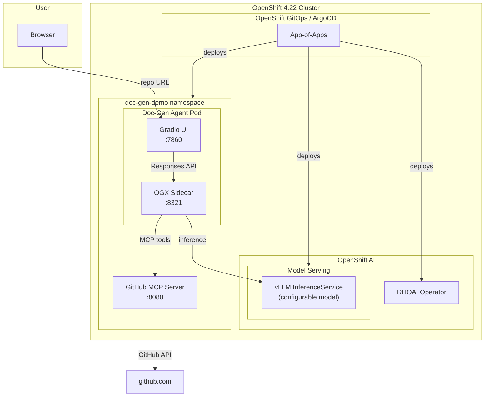

# Agentic Doc Generation — OpenShift AI Demo

A GitOps-provisioned demo showing AI agents + a locally-served model on
**OpenShift AI** automating architecture documentation and diagram
generation — a simplified, single-agent take on
[opendatahub-io/architecture-context](https://github.com/opendatahub-io/architecture-context).

Give the agent a GitHub repository URL. It explores the repo via a GitHub
MCP server, then a model served locally by vLLM on OpenShift AI (no
external LLM API calls) synthesizes an architecture document with
embedded Mermaid diagrams.

## How it works



Agent workflow, simplified from architecture-context's six-phase pipeline
down to one agent turn:

1. User pastes a GitHub repo URL into the Gradio chat UI
2. Agent calls `get_repo_info` (default branch, language) then
   `get_repo_structure` (filtered file tree) on the GitHub MCP server
3. Agent reads the ~15-20 most architecturally relevant files (README,
   entry points, manifests, Dockerfiles, k8s/CI configs)
4. The local model (served via vLLM on OpenShift AI) synthesizes a
   structured architecture document: overview, tech stack, components,
   data flow, external dependencies, deployment, security
5. The model generates three Mermaid diagrams (component, data flow,
   dependency), embedded directly in the Markdown response
6. Everything streams back into the chat UI

## Prerequisites

- An OpenShift **4.22** cluster, logged in as `cluster-admin` (`oc login`)
- At least one GPU-capable node (the default model needs ~1 GPU, 16-24Gi
  memory — see [Model configurability](#model-configurability) to pick a
  smaller model if no GPU is available)
- `oc` CLI
- This repo pushed to a git remote reachable by the cluster (GitHub,
  GitLab, or an internal git server) — ArgoCD needs to clone it
- (Optional) A `GITHUB_TOKEN` with `public_repo` scope, to raise GitHub
  API rate limits and enable the `search_code` tool

## Quick start (GitOps)

```bash
git clone <your-fork-of-this-repo>
cd agentic-doc-generation
./gitops/bootstrap.sh
```

This single command:

1. Installs the OpenShift GitOps operator (if not already present) and
   waits for ArgoCD to come up
2. Points the root ArgoCD Application (`gitops/root-app.yaml`) at your
   repo and applies it
3. ArgoCD then reconciles everything else, in dependency order via
   sync-waves:
   - **Wave 0** — RHOAI operator (Subscription, OperatorGroup) +
     DSCInitialization/DataScienceCluster (enabling only KServe +
     dashboard, in RawDeployment mode — no Service Mesh dependency)
   - **Wave 1** — `doc-gen-demo` namespace, vLLM `ServingRuntime` +
     `InferenceService` (Granite 3.1 8B by default), GitHub MCP server
   - **Wave 2** — the doc-gen agent (Gradio UI + OGX sidecar)

The script finishes by printing the ArgoCD UI route. Watch progress with:

```bash
oc get applications -n openshift-gitops -w
```

> **Note:** `bootstrap.sh` edits `gitops/apps/*.yaml` in place to
> substitute your repo's URL (ArgoCD Applications can't template this at
> apply-time). Commit and push that change so ArgoCD's view of the repo
> matches what you applied:
> ```bash
> git add gitops/apps && git commit -m "gitops: point apps at repo" && git push
> ```

Once `doc-gen-agent` is `Synced`/`Healthy`, get the UI route:

```bash
oc get route doc-gen-agent -n doc-gen-demo -o jsonpath='https://{.spec.host}{"\n"}'
```

## Quick start (without GitOps)

For local iteration on the application components only (assumes the
RHOAI operator + model serving are already deployed, e.g. via
`gitops/bootstrap.sh` or `oc apply -k gitops/operators/rhoai && oc apply -k gitops/model-serving`):

```bash
export GITHUB_TOKEN=ghp_xxx   # optional, raises rate limits + enables search_code
./build-and-deploy-all.sh
```

Or deploy a single component:

```bash
./build-and-deploy-all.sh github-mcp-server
./build-and-deploy-all.sh doc-gen-agent
```

## Demo walkthrough

1. Open the doc-gen agent route in a browser
2. Paste a repo URL, e.g. `https://github.com/quarkusio/quarkus-quickstarts`
   (or use one of the example buttons in the UI)
3. Watch the agent:
   - Call `get_repo_info` → learns the default branch and primary language
   - Call `get_repo_structure` → sees the filtered file tree
   - Call `read_file` repeatedly → reads the README, main source files,
     build manifests, Dockerfiles, k8s manifests
   - Stream back a full architecture document with three embedded Mermaid
     diagrams (component, data flow, dependency)
4. Try a few different repos to see how the output adapts — a small CLI
   tool produces a much shorter document than a multi-service platform

## Model configurability

The default model is **Granite 3.1 8B Instruct** (smallest GPU footprint
of the three, Red Hat pedigree). To swap models, edit exactly two files
and let ArgoCD (self-heal) or `./doc-gen-agent/build-and-deploy.sh`
pick up the change:

| File | What to change |
|---|---|
| [`gitops/model-serving/inference-service.yaml`](gitops/model-serving/inference-service.yaml) | `spec.predictor.model.storageUri` |
| [`doc-gen-agent/k8s/cluster-config.yaml`](doc-gen-agent/k8s/cluster-config.yaml) | `data.model_name` |
| [`doc-gen-agent/ogx/stack_run_config.yaml`](doc-gen-agent/ogx/stack_run_config.yaml) | `registered_resources.models[0].model_id` / `provider_model_id` |

Supported examples (all served by the same `vllm-runtime` ServingRuntime):

| Model | `storageUri` | `model_name` |
|---|---|---|
| Granite 3.1 8B Instruct (default) | `oci://registry.redhat.io/rhelai1/modelcar-granite-3-1-8b-instruct:1.4` | `granite-3.1-8b-instruct` |
| Mistral 7B Instruct v0.3 | `hf://mistralai/Mistral-7B-Instruct-v0.3` | `mistral-7b-instruct-v0.3` |
| Llama 3.1 8B Instruct | `hf://meta-llama/Llama-3.1-8B-Instruct` | `llama-3.1-8b-instruct` |

If using GitOps, commit and push the change — ArgoCD's `selfHeal` will
roll it out automatically.

## Project structure

```
agentic-doc-generation/
├── gitops/
│   ├── bootstrap.sh                     # Install GitOps operator, apply root app
│   ├── root-app.yaml                    # ArgoCD App-of-Apps
│   ├── openshift-gitops-subscription.yaml
│   ├── operators/rhoai/                 # RHOAI operator + DSCI/DSC (sync-wave 0)
│   ├── model-serving/                   # Namespace, vLLM ServingRuntime, InferenceService (sync-wave 1)
│   └── apps/                            # Child ArgoCD Applications (one per component)
├── github-mcp-server/                   # FastMCP server: get_repo_info, get_repo_structure, read_file, search_code
│   ├── server.py
│   ├── Dockerfile
│   ├── build-and-deploy.sh
│   └── k8s/
├── doc-gen-agent/                       # OGX sidecar + Gradio UI
│   ├── agent.py                         # OGX Responses API agent, architecture-focused system prompt
│   ├── app.py                           # Gradio chat UI
│   ├── knowledge.md                     # Documentation style guide injected into the agent prompt
│   ├── ogx/stack_run_config.yaml        # OGX + vLLM model config
│   ├── build-and-deploy.sh
│   └── k8s/
├── build-and-deploy-all.sh              # Quick-start (non-GitOps) for app components
└── README.md
```

## Known limitations

- This demo analyzes **public** GitHub repos only (the GitHub MCP server
  uses unauthenticated or token-based REST calls, no OAuth flow).
- `search_code` requires a `GITHUB_TOKEN` (GitHub's code search API does
  not support unauthenticated requests).
- The agent reads file contents one at a time; very large monorepos will
  hit the `MAX_INFER_ITERS` / token-budget guardrails in
  [`doc-gen-agent/agent.py`](doc-gen-agent/agent.py) and produce a
  partial-but-useful document rather than exhaustive coverage — this
  mirrors the token-budget tuning notes in the reference
  ocp-troubleshooter-demo.
- RawDeployment-mode KServe (chosen here to avoid a Service
  Mesh/Knative dependency) does not create an external Route for the
  model — it's only reachable in-cluster, which is sufficient since the
  OGX sidecar is its only consumer.
